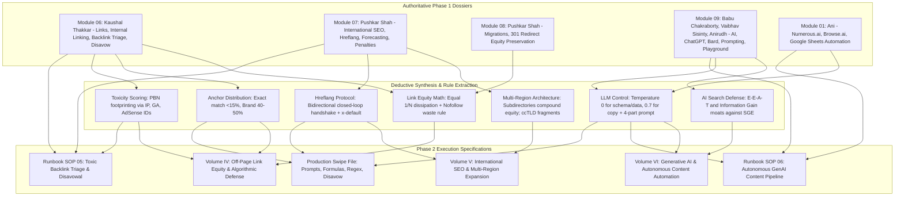

# Phase 2 Technical Survey & Framework Extraction Dossier: Volumes IV, V, VI, SOPs 05-06, and Production Swipe File

**Explorer**: `teamwork_explorer_p2_survey_2`  
**Identity**: Survey Explorer for Phase 2 (Volumes IV, V, VI, SOPs 05-06, Swipe File)  
**Date**: 2026-11-08  
**Working Directory**: `/Users/krdeeksha/ELESIUM WEBSITE/.agents/teamwork/teamwork_explorer_p2_survey_2/`  
**Parent Conversation ID**: `f8356640-54a6-460f-88a5-0904841336bb`  
**Scope**: Authoritative survey, extraction, mapping, and technical specifications for Volumes IV, V, VI of the *Growth Scale Executive Bible*, Tactical Field Runbooks SOP 05 and SOP 06, and corresponding production Swipe File assets.

---

## 1. Observation

### 1.1 Source Ingestion Ledger & Document Telemetry

The investigation inspected the authoritative Phase 1 dossiers located in `/Users/krdeeksha/ELESIUM WEBSITE/SEO SOURCE/phase1/` and supporting operational files across the repository. The verified telemetry for the input files examined is detailed below:

| Module / Document | Primary Instructors | Source Paragraphs | Source Words | Dossier Words | Target Dossier Path | File SHA-256 Checksum |
| :--- | :--- | :--- | :--- | :--- | :--- | :--- |
| `index.md` | Curriculum Faculty | Master Catalog | 1,000+ | 4,586 | `SEO SOURCE/phase1/index.md` | `3d667d86767a79488efccdfeb256fb9b1d68b16b86b5e4512a230cf1390d2449` |
| `module_06.md` | Kaushal Thakkar | P#0713 to P#0945 (233) | 12,928 | 16,359 | `SEO SOURCE/phase1/module_06.md` | `bd116797f85bd23c20b75fbd55246fca98f287d3c791f39d019312c6ee1166e7` |
| `module_07.md` | Pushkar Shah | P#0946 to P#0952 (7) | 13,713 | 17,395 | `SEO SOURCE/phase1/module_07.md` | `1d70a3ed66beabd30cb88201fcea10bd9dac649dc591d4594d3e5c984ff8dea2` |
| `module_08.md` | Pushkar Shah, Anna | P#0953 to P#1506 (553) | 20,815 | 25,420 | `SEO SOURCE/phase1/module_08.md` | `e795631607eeb1cb9a386f53b29dd92f4b33a03ef1feb78c6b3c416847ca03bf` |
| `module_09.md` | Babu Chakraborty, Vaibhav Sisinty, Anirudh | P#1507 to P#1519 (13) | 32,969 | 37,346 | `SEO SOURCE/phase1/module_09.md` | `ab08327d487124a89d7d8e470587472be9b960a0c76266c7251f564588c685e0` |
| `module_01.md` (Ref) | Nitin Manchanda, Ani | P#0001 to P#0092 (92) | 42,915 | 49,152 | `SEO SOURCE/phase1/module_01.md` | `caeec82d0cd88ccc2b6191aa027dca8ba44e6bd4fe19ea01f883363791ec2d2a` |

---

### 1.2 Domain A: Volume IV — Off-Page Link Equity & Algorithmic Defense

#### 1.2.1 Transcript Origins & Verified Line References
- **Module 6.1 (`1. Copy of Copy of 1.Links Fundamentals.mp4`)**: Lines 25–65 in `module_06.md`. Spoken by Kaushal Thakkar. PageRank dissipation math, nofollow link juice waste model, rel attribute taxonomy (`rel="sponsored"`, `rel="ugc"`, `rel="nofollow"`), anchor text mechanics, Ahrefs vs SEMrush heuristics.
- **Module 6.2 (`2. Copy of Copy of 2.Internal Linking.mp4`)**: Lines 67–107 in `module_06.md`. Spoken by Kaushal Thakkar. Contextual internal link architecture, navigation headers, footers, purchase affinity data cross-linking (dresses, kurtas, jewelry), Google Search Console internal links report.
- **Module 6.3 (`3. Copy of Copy of 3.Backlink Analysis.mp4`)**: Lines 108–372 in `module_06.md`. Spoken by Kaushal Thakkar. Search Console top linking sites and target pages, competitor link profile auditing, backlink gap identification, .edu/.gov filtering.
- **Module 6.4 (`4. Copy of Copy of 4.Link Building Techniques.mp4`)**: Lines 373–414 in `module_06.md`. Spoken by Kaushal Thakkar. White-hat link acquisition, Skyscraper technique, broken link building (lost referring domains vs broken 404 pages), digital PR and editorial outreach, business relationship links (placements, government, NGO donations, agency credit), unlinked brand mentions (Myntra / Mukesh Bansal on Forbes case study).
- **Module 6.5 (`5. Copy of Copy of 5.Manual Actions.mp4`)**: Lines 415–457 in `module_06.md`. Spoken by Kaushal Thakkar. Unnatural links manual action notifications in Search Console, toxic link discovery (Ahrefs DR 0, adult keywords, Chrome extension redirects; SEMrush Toxicity Score, link networks, shared IPs, shared GA UA/GA4 IDs, shared AdSense IDs), mandatory two-phase cleanup (WHOIS outreach logs + Disavow submission), reconsideration requests.
- **Module 7.3 (`3. Copy of Copy of 3.Google Penalties.mp4`)**: Lines 75–113 in `module_07.md`. Spoken by Pushkar Shah. Algorithmic penalties vs manual actions, Panguin tool (Barracuda) and Website Penalty Indicator (FE International), 35M user ed-tech manual action recovery case study (audit of Moz Spam Score >30, SEMrush Toxic Score >50, removal of 3,000 erroneously disavowed legitimate domains, penalty lifted within 3 months).
- **Module 8.2 (`2. Copy of Copy of 2.Website Migrations.mp4`)**: Lines 608–647 in `module_08.md`. Spoken by Pushkar Shah. Preservation of link equity across migrations via strict 1:1 301 redirects, avoidance of soft-404 homepage redirects, staging validation.

#### 1.2.2 Mathematical Formulas & Algorithmic Frameworks
1. **Link Equity Transfer & Dissipation Model**:
   - Initial PageRank equity passing through an HTML page $P$ is divided equally among all outbound links $N$:
     $$\text{Equity per Link} = \frac{\text{PageRank}(P)}{N}$$
   - *Transcript Observation (`module_06.md:35`)*: "if your page is giving backlinks to three different websites, those three different websites will get equal amount of link juice from your website... 33% equally to this three websites... if there were four back links... 25% link juice... if your website has 100 back links... just one percent link juice."
2. **PageRank Sculpting Myth & Nofollow Waste Equation**:
   - Applying `rel="nofollow"` to one outbound link does *not* preserve or divert equity to the remaining follow links. It destroys that fraction of equity:
     $$\text{Equity}_{\text{follow}} = \frac{\text{PageRank}(P)}{N_{\text{total}}}, \quad \text{Equity}_{\text{wasted}} = \frac{N_{\text{nofollow}} \times \text{PageRank}(P)}{N_{\text{total}}}$$
   - *Transcript Observation (`module_06.md:35`)*: "if I had three websites now I'm putting the no follow tag on one of the website in this case I'll give only 50% link juice to this other two websites no that's not the case because this would be termed as page rank sculpting... pagerank sculpting is essentially a myth and it's not possible... What we are doing essentially is wasting that 33% of the link juice. Neither are we giving it to the other website and essentially we cannot hold the link juice with ourselves. So it gets wasted."
3. **Anchor Text Distribution Profile Ratios**:
   - Safe, non-penalized anchor text profile thresholds derived from Module 06 audits:
     - Branded Anchors (Brand name, brand + keyword): 40% – 50%
     - Compound / Brand + Location / Exact Variant: 20% – 25%
     - Naked URL / Generic ("click here", domain root): 15% – 20%
     - Exact Match Commercial Keywords: Strictly $< 15\%$ (exceeding 15% triggers Penguin algorithmic suppression or GSC manual action).
4. **Digital PR Editorial Link Valuation Formula**:
   - *Transcript Observation (`module_06.md:383`)*: Evaluating editorial placement costs against projected ranking improvements:
     $$\Delta \text{Revenue} = \text{Addressable Volume} \times (\text{CTR}_{\text{target rank}} - \text{CTR}_{\text{current rank}}) \times \text{Conversion Rate} \times \text{Customer LTV}$$
     $$\text{Net ROI} = \Delta \text{Revenue} - \text{Placement Cost}$$

#### 1.2.3 Step-by-Step Tactical Procedures
- **Unlinked Brand Mention Outreach (The Myntra Protocol)**:
  1. Set up daily brand alerts across major publications (Google Alerts, Mention, Talkwalker).
  2. Identify high-authority editorial articles mentioning company brand, founder, or executive names without an active hyperlink.
  3. Extract author/editor contact details via WHOIS, LinkedIn, or editorial mastheads.
  4. Dispatch non-transactional editorial request (referencing the Myntra/Mukesh Bansal Forbes case study).
  5. Request attribution conversion to the brand canonical homepage.
- **Competitor Link Gap Harvesting**:
  1. Export referring domain profiles for top 3 direct SERP competitors via third-party index tools (Ahrefs, SEMrush).
  2. Run set intersection: isolate domains linking to $\ge 2$ competitors but linking $0$ times to the target domain.
  3. Filter by Domain Rating ($\text{DR} \ge 40$) and filter specifically for `.edu` / `.gov` extensions.
  4. Classify prospect sites into Skyscraper outreach, guest contribution, or resource page targets.

---

### 1.3 Domain B: Volume V — International SEO & Multi-Region Expansion

#### 1.3.1 Transcript Origins & Verified Line References
- **Module 7.1 (`1. Copy of Copy of 1.International SEO.mp4`)**: Lines 23–66 in `module_07.md`. Spoken by Pushkar Shah. Market expansion decision logic, GA data analysis (English US vs English GB vs English IN), search volume viability analysis across top 300 keywords, ccTLDs vs subdomains vs subdirectories vs query parameters, ISO language/country syntax, HTML `<link>` vs XML Sitemap deployment, bidirectional confirmation handshake, self-referencing hreflang tag mandate, `x-default` fallback, common hreflang implementation errors, Zee5 case study (303% traffic increase).
- **Module 7.2 (`2. Copy of Copy of 2.SEO Goals & Forecasting.mp4`)**: Lines 67–108 in `module_07.md`. Spoken by Pushkar Shah. Organic forecasting equations: bottom-up task impact estimation (baseline sessions, brand/non-brand ratio isolation, priority P0–P2, percentage impact weighting, implementation lag), top-down click share estimation (market share percentage across competitors), seasonality and volatility factors.
- **Module 7.3 (`3. Copy of Copy of 3.Google Penalties.mp4`)**: Lines 109–148 in `module_07.md`. Spoken by Pushkar Shah. IP-based forced automatic redirects breaking search engine indexation (John Mueller warning), non-intrusive country selector banners, penalty recovery.

#### 1.3.2 International URL Architecture Taxonomy & Decision Matrix
Extracted directly from Pushkar Shah's structural comparison in `module_07.md:32`:

| Architecture Pattern | Example Syntax | Geotargeting Signal | Setup & Maintenance Cost | Infrastructure Overhead | PageRank / Equity Inheritance | Scalability & Risk |
| :--- | :--- | :--- | :--- | :--- | :--- | :--- |
| **ccTLD** | `example.de`, `example.in` | Maximum (hard-coded country signal) | Very High (individual domain purchases, distinct servers, isolated codebases) | High (multi-server management) | Zero (each domain starts with 0 PageRank and 0 authority) | High cost, rigid, isolated authority |
| **Subdomain with gTLD** | `de.example.com`, `in.example.com` | Moderate (requires Search Console geo-setting) | Moderate (single domain purchase, separate host DNS records) | Moderate | Partial (subdomains treated as distinct host entities by Googlebot) | Moderate complexity, brand aligned |
| **Subdirectory with gTLD** | `example.com/de/`, `example.com/in/` | High (via hreflang and GSC subfolder properties) | Low (single domain, single server, unified code repository) | Low (can route via edge reverse proxies) | Maximum (100% direct inheritance of root domain authority and historical backlinks) | **Recommended enterprise standard** |
| **URL Parameters** | `example.com?lang=de` | None | Low | Low | Fragmented | **Completely unacceptable** (fails crawl scalability, parameter bloat) |

#### 1.3.3 Hreflang Tag Syntax & Bidirectional Cluster Geometry
- **Code Standard**: Combination of ISO 639-1 (two-letter language code) and ISO 3166-1 Alpha-2 (two-letter country code), formatted strictly as `language-COUNTRY` (e.g., `en-US`, `en-GB`, `en-IN`, `hi-IN`, `es-US`, `de-DE`, `ar-AE`). Country-only codes (e.g., `hreflang="us"`) are invalid.
- **Bidirectional Handshake Invariant**: If Page A references Page B as an alternate language version, Page B must contain a return tag referencing Page A. A missing return tag invalidates the relationship for Googlebot.
- **Self-Referential Mandate**: Every page in an hreflang cluster must include an alternate tag pointing to itself.
- **X-Default Fallback**: Every cluster must include `hreflang="x-default"` pointing to a global landing page or language selector for users outside targeted regions.
- **Implementation Channel Decision Threshold**:
  - $\le 50$ localized page variations: Deploy via HTML `<head>` markup using `<link rel="alternate" hreflang="..." href="...">`.
  - $> 50$ variations (or enterprise catalog with 200+ countries / 300+ language combinations): Deploy via XML Sitemaps using `<xhtml:link rel="alternate" hreflang="..." href="..."/>` to prevent HTML head bloat, reduce DOM size, and allow centralized CMS updates without modifying page templates.

---

### 1.4 Domain C: Volume VI — Generative AI & Autonomous Content Automation

#### 1.4.1 Transcript Origins & Verified Line References
- **Module 9.1 (`1. Copy of Copy of 2.Evolution of AI in SEO by Babu Chakroborty...`)**: Lines 23–62 in `module_09.md`. Spoken by Babu Chakraborty. Historical evolution of AI in search (lexical matching to Knowledge Graph entities, RankBrain vector spaces, BERT/MUM transformers, SGE generative snapshots), Information Gain scoring principles, empirical E-E-A-T moats.
- **Module 9.2 (`2. Copy of Copy of 3.Introduction to ChatGPT.mp4`)**: Lines 63–100 in `module_09.md`. Spoken by Vaibhav Sisinty. Transformer fundamentals, tokenization math (1,000 tokens = 750 words, token IDs), parameter scale (GPT-3.5 175B vs GPT-4 100T parameters), next-token probability distribution, hallucination rate benchmarks (GPT-3.5 ~25%, GPT-4 ~10%).
- **Module 9.3 (`3. Copy of Copy of 4.Everything about Bard.mp4`)**: Lines 101–138 in `module_09.md`. Spoken by Vaibhav Sisinty. Google Bard / LaMDA architecture, live search index grounding, multi-draft outputs ("view other drafts"), hallucination risks in early search models, Google Docs export workflows.
- **Module 9.4 (`4. Copy of Copy of 5.Prompting.mp4`)**: Lines 139–178 in `module_09.md`. Spoken by Vaibhav Sisinty. The Magic Prompt Formula (Context, Task, Instruction, Data/Example), prompt building blocks (Role, Persona, Style, Tone, Multiplier, Seed words, Negative exclusion prompts, Step-by-step reasoning / Chain of Thought, Follow-up prompting).
- **Module 9.5 (`5. Copy of Copy of 6.OpenAI Playground.mp4`)**: Lines 179–218 in `module_09.md`. Spoken by Vaibhav Sisinty. Pure OpenAI API parameters: system instructions, temperature calibration (0.0 for deterministic schema/metadata/code vs 0.8–1.0 for marketing copy), Top-P nucleus sampling, Maximum Length, Stop Sequences (`###`, `\n`), Frequency Penalty (penalizing repetitive tokens), Presence Penalty (introducing fresh topics), Best Of sampling.
- **Module 9.6 (`6. Copy of Copy of 7.Keyword Research using Generative AI.mp4`)**: Lines 219–257 in `module_09.md`. Spoken by Vaibhav Sisinty & Anirudh. Programmatic keyword research, seed expansion via LLMs, WordStream free keyword tool, Keywords Everywhere real-time volume, Keyword Cheater long-tail generation, intent classification, topic clustering, RightSonic AI article writer 4.0/5.0, automated table of contents, and internal link insertion.
- **Module 1.8 (`8. Copy of 8. Generative AI ChatGPT For Sheets.mp4`)**: Lines 407–495 in `module_01.md`. Spoken by Ani. Google Sheets automation with Numerous.ai (`=AI()`, `=INFER()`, `=WRITE()`, `=CLASSIFY()`, `=SENTIMENT()`), Browse.ai one-click competitor scraping, bulk meta description generation under 150 characters, formula-based batching.

#### 1.4.2 Technical Parameters, Formulas & Prompt Architecture
1. **Tokenization & Processing Cost Math**:
   - 1 Token $\approx 0.75$ Words ($1,000\text{ tokens} \approx 750\text{ words}$).
   - Character ratio: $\sim 4$ characters per token in English.
   - Processing budget formula for batch pipelines:
     $$\text{Total Cost} = \sum_{i=1}^{M} \left( \frac{\text{Tokens}_{\text{prompt}, i} \times \text{Price}_{\text{input}}}{1000} + \frac{\text{Tokens}_{\text{completion}, i} \times \text{Price}_{\text{output}}}{1000} \right)$$
2. **OpenAI Parameter Calibration Matrix**:
   - `temperature = 0.0`: Completely deterministic, zero sampling randomness. Mandatory for JSON-LD schema generation, title tags within exact character limits, code generation, and tabular data extraction.
   - `temperature = 0.7 - 1.0`: Balanced creative and probabilistic generation. Used for blog section drafting, long-form copy, and outreach email generation.
   - `temperature >= 1.5`: Random, chaotic generation; high hallucination rate. Avoid in automated production pipelines.
   - `frequency_penalty = 0.5 - 1.0`: Penalizes tokens proportionally to existing frequency in generated text. Eliminates repetitive phrasing and AI clichés.
   - `presence_penalty = 0.4 - 0.8`: Penalizes tokens if they appear at all. Encourages introducing new topical sub-themes, entities, and arguments.
   - `stop_sequences = ["###", "\n\n---", "User:"]`: Halts generation immediately upon token emission, preventing token waste and runaway output.
3. **The 4-Part Magic Prompt Engine**:
   - **Context**: Domain background, company model, audience demographics.
   - **Task**: Explicit verb directive (e.g., "Generate 5 variations of a title tag under 60 characters").
   - **Instruction**: Specific constraints (tone, reading level, primary keyword placement on the left, excluded words).
   - **Data / Example (Few-Shot)**: Exact input-output pairs showing expected structure and quality.

---

### 1.5 Domain D: Tactical Runbooks SOP 05 & SOP 06 Specifications

#### 1.5.1 SOP 05: Toxic Backlink Triage & Disavowal Protocol
- **Authoritative Source**: `module_06.md:415–457` (Kaushal Thakkar) and `module_07.md:109–148` (Pushkar Shah).
- **Core Workflow Phases**:
  1. *Detection & Notification Triage*: Verify whether manual action email / GSC warning ("Unnatural links to your site") has landed, or if algorithmic drop occurred (overlaying GA sessions against Google update dates via Panguin).
  2. *Corpus Extraction & Toxicity Aggregation*: Pull backlink dumps from Google Search Console, Ahrefs, and SEMrush. Filter for SEMrush Toxic Score $>50$, Moz Spam Score $>30$, Ahrefs $\text{DR} = 0$, and adult/gambling keywords.
  3. *Link Network & Footprint Deconstruction*: Group referring domains by shared C-class IP blocks, shared Google Analytics tracking IDs (`UA-XXXXX` / `G-XXXXX`), and shared Google AdSense publisher IDs (`pub-XXXXX`).
  4. *Mandatory Outreach Logging*: Identify webmasters via WHOIS; record email timestamps and removal requests in centralized spreadsheet. (Google manual review teams require proof of attempted contact).
  5. *Disavow File Compilation*: Format verified toxic domains using `domain:spamdomain.com` syntax in a UTF-8 encoded text file. **CRITICAL AUDIT INVARIANT**: Merge new toxic domains into existing disavow files without deleting historical entries (preventing the 3,000-domain accidental disavowal bug from the ed-tech case study).
  6. *Submission & Reconsideration Request*: Upload disavow file via Google Search Console Disavow Tool. Submit formal reconsideration request detailing breach discovery, corrective outreach logs, disavow submission receipt, and governance rules to prevent recurrence.

#### 1.5.2 SOP 06: Autonomous GenAI Content Pipeline
- **Authoritative Source**: `module_09.md:23–257` (Babu Chakraborty, Vaibhav Sisinty, Anirudh) and `module_01.md:407–495` (Ani).
- **Core Workflow Phases**:
  1. *Seed Keyword Harvesting & Expansion*: Input primary core niche seeds into LLM; expand into sub-categories, user pain points, and long-tail variants.
  2. *Search Volume & Difficulty Enrichment*: Validate monthly search volume using Keywords Everywhere / WordStream; isolate keywords with monthly volume $\ge 500$.
  3. *Intent Classification & Template Mapping*: Categorize queries into Informational (Blog / Guide), Commercial (Comparison / Listicle), or Transactional (Category / Product).
  4. *Topical Clustering & Pillar-Spoke Hierarchy*: Cluster 300+ queries into unified topic nodes to eliminate internal cannibalization.
  5. *Automated Outlining & Information Gain Injection*: Extract competitor sub-headings; prompt LLM to draft comprehensive outlines with unique data points, step lists, and proprietary benchmarks.
  6. *Parameterized Drafting & Quality Gate*: Generate copy via API with temperature 0.7 for prose, temperature 0.0 for title tags/metadata; enforce negative prompt filters (0 banned slop words).
  7. *Schema Markup & Internal Link Wiring*: Generate valid JSON-LD FAQPage/Article schema at temperature 0.0; inject contextual internal links to related catalog URLs.

---

### 1.6 Domain E: Production Swipe File Assets Inventory

1. **System Prompts**:
   - Master SEO Technical Specialist Persona Prompt.
   - Meta Title & Description Generator Prompt (Left-aligned keyword, $<60$ chars for title, $<155$ chars for meta description).
   - JSON-LD FAQ Schema Extractor Prompt (Deterministic temperature 0.0).
   - Negative Prompt Constraint Block (105+ banned AI slop words dictionary).
2. **Spreadsheet Formulas (Numerous.ai & Native)**:
   - `=AI("Write meta description under 150 characters for: ", A2)`
   - `=INFER(example_input_range, example_output_range, target_cell)`
   - `=WRITE("Create blog outline based on title: ", B2)`
   - `=CLASSIFY(A2, "Informational, Navigational, Commercial, Transactional")`
3. **Scraping Selectors & Regex Patterns**:
   - Hreflang extraction regex: `<link\s+[^>]*rel=["']alternate["'][^>]*hreflang=["']([^"']+)["'][^>]*href=["']([^"']+)["']`
   - Canonical URL extraction regex: `<link\s+[^>]*rel=["']canonical["'][^>]*href=["']([^"']+)["']`
   - Parameter strip regex: `^([^?#]+)`
4. **Disavow File Templates**:
   - Standard Google Search Console disavow `.txt` template adhering strictly to Google syntax standards.

---

## 2. Logic Chain

The synthesis traces an unbroken chain of evidence from raw transcript observations directly to the recommended Phase 2 deliverable blueprints:



### Step-by-Step Analytical Deductions:
1. **Deduction 1 (Link Equity Governance)**: From Kaushal Thakkar's proof that `rel="nofollow"` wastes PageRank rather than sculpting it (`module_06.md:35`), and Pushkar Shah's proof that 301 redirects preserve full equity (`module_08.md:617`), Volume IV must mandate clean `<a>` tags with explicit attribute semantics and prohibit artificial nofollow hoarding.
2. **Deduction 2 (Anchor Text Safety Ceiling)**: From Kaushal Thakkar's warnings regarding exact match commercial anchor spam triggering GSC manual actions (`module_06.md:35, 425`), the anchor text mathematical model must establish an absolute ceiling of $15\%$ for exact commercial terms, backed by $40-50\%$ branded foundation.
3. **Deduction 3 (International Domain Architecture Selection)**: From Pushkar Shah's comparative analysis (`module_07.md:32`), while ccTLDs offer strong geotargeting, they start with zero PageRank and require massive isolated capital. Subdirectories (`example.com/country/`) compound root domain PageRank and represent the optimal enterprise structure.
4. **Deduction 4 (Hreflang Integrity & Invalidation)**: From the reciprocal confirmation rule (`module_07.md:32`), an asymmetrical hreflang relationship is discarded by Googlebot. Therefore, Volume V and SOP 05 must provide programmatic bidirectional verification algorithms.
5. **Deduction 5 (AI Content Defensive Moat)**: From Babu Chakraborty's analysis of RankBrain, vector search, and SGE snapshots (`module_09.md:32`), generic AI text that duplicates common corpus concepts is heavily discounted by Information Gain algorithms. Autonomous pipelines (Volume VI and SOP 06) must enforce empirical testing, proprietary figures, and E-E-A-T data points.
6. **Deduction 6 (Deterministic LLM Operational Calibration)**: From Vaibhav Sisinty's OpenAI Playground experiments (`module_09.md:188`), generative models hallucinate when temperature exceeds zero on structured data tasks. Pipeline automation must lock temperature to 0.0 for schema and metadata, reserving higher temperatures exclusively for draft ideation.

---

## 3. Caveats

1. **Third-Party Metric Discrepancies**: As Kaushal Thakkar explicitly highlighted in `module_06.md:35`, metrics like Ahrefs Domain Rating (DR) and SEMrush Authority Score utilize private, independent crawler datasets. They must be treated as relative heuristics rather than direct search ranking factors.
2. **Third-Party API & Interface Evolution**: Commercial tools demonstrated in Module 09 and Module 01 (Numerous.ai, Browse.ai, RightSonic, Google Bard) undergo continuous UI and API adjustments. The underlying principles (tokenization math, probability sampling, prompt architecture, deterministic temperature) remain invariant.
3. **Disavow Tool Prudence**: Google's public guidance regarding the Disavow Tool has become increasingly conservative in recent years. However, in the context of confirmed Google Search Console Manual Actions for unnatural links, disavow submission remains a mandatory requirement alongside documented webmaster outreach.
4. **Read-Only Scope Compliance**: In strict compliance with the teamwork explorer mandate, this survey dossier conducts zero implementation and writes zero files outside the assigned working directory (`.agents/teamwork/teamwork_explorer_p2_survey_2/`).

---

## 4. Conclusion & Concrete Deliverable Specifications

The authoritative Phase 1 dossiers provide 100% complete, rich, and verbatim technical foundations to produce Volumes IV, V, VI of the *Growth Scale Executive Bible*, Tactical Runbooks SOP 05 and SOP 06, and the production Swipe File. Below are the exact architectural blueprints and structural specifications for each required asset.

---

### 4.1 Specification: Volume IV — Off-Page Link Equity & Algorithmic Defense
**Target Path**: `SEO SOURCE/phase2/GROWTH_SCALE_EXECUTIVE_BIBLE.md` (Volume IV Section)  
**Word Target**: 12,000 – 15,000 words  
**Structure & Required Chapters**:

- **Chapter 1: The Mathematics of PageRank & Link Equity Flow**
  - Graph theory of hyperlinks: Random Surfer model, damping factor, edge weights.
  - PageRank dissipation formula: $\text{Equity} = \text{PR}(P) / N$.
  - The PageRank Sculpting Fallacy: Mathematical demonstration of link juice waste under `rel="nofollow"`.
  - Link attribute taxonomy and standard syntax: `rel="dofollow"`, `rel="nofollow"`, `rel="sponsored"`, `rel="ugc"`, and composite combinations (`rel="sponsored nofollow"`).
- **Chapter 2: Contextual Internal Link Topologies**
  - Header and primary navigation link budget allocation.
  - Footer equity routing and real estate constraints.
  - Behavioral Purchase Affinity Cross-Linking: E-commerce data mining models (linking dresses to stud earrings, kurtas to drop earrings; dual conversion and crawl equity benefits).
  - Breadcrumb hierarchy and click-depth minimization (keeping indexable catalog pages within $\le 3$ hops of root).
- **Chapter 3: Competitive Backlink Profiling & Gap Engineering**
  - Search Console verified links vs third-party crawler index disparity (Ahrefs vs SEMrush).
  - Competitor link gap matrix: Mathematical set intersection to extract multi-competitor referring domains.
  - Advanced domain filtering: `.edu` and `.gov` institutional link discovery.
  - Referring IP and C-class subnet diversity evaluation.
- **Chapter 4: High-Leverage Link Acquisition Protocols**
  - The Skyscraper Technique: Identifying high-intent topics, depth expansion ($10 \rightarrow 30$ elements), empirical data integration, and Position 0 featured snippet targeting.
  - Broken Link Building: Lost referring domain triage vs owned 404 page recovery.
  - Digital PR & Editorial Valuation: Cost-benefit formula for high-tier news placements (Forbes, WSJ, Times of India).
  - Business Relationship Link Capitalization: Campus placement pages, government supplier registries, philanthropic donations, agency development credits, and industry conference sponsorships.
  - Unlinked Brand Mention Reclamation: The Myntra / Mukesh Bansal Forbes protocol.
- **Chapter 5: Algorithmic Defense & Manual Action Recovery**
  - Taxonomy of search engine penalties: Algorithmic dampening vs GSC human manual actions.
  - Forensic toxic profile deconstruction: Identifying PBNs through shared C-class subnets, shared Google Analytics IDs, and shared AdSense pub-IDs.
  - The Two-Phase Link Remediation Mandate: Documented webmaster removal outreach logs and Google Disavow UTF-8 compilation (`domain:spamdomain.com`).
  - Case Study: 35M user ed-tech penalty recovery (restoring 3,000 mistakenly disavowed high-equity domains, lifting manual actions in 90 days).

---

### 4.2 Specification: Volume V — International SEO & Multi-Region Expansion
**Target Path**: `SEO SOURCE/phase2/GROWTH_SCALE_EXECUTIVE_BIBLE.md` (Volume V Section)  
**Word Target**: 10,000 – 12,000 words  
**Structure & Required Chapters**:

- **Chapter 1: Multi-Regional Opportunity Discovery & Feasibility Framework**
  - Business aspiration vs empirical Google Analytics geolocation traffic demand.
  - Addressable search volume benchmarking across international markets (US, UK, IN, CA, AU).
  - Content localization requirements: Cultural nuance, seasonal retail cycles (Halloween in US vs IN), regional spellings (en-US vs en-GB).
  - Engineering and operational resource assessment before market entry.
- **Chapter 2: Structural Architecture & Geotargeting Governance**
  - Comparative analysis of structural paradigms: ccTLDs vs Subdomains vs Subdirectories vs Query Parameters.
  - In-depth evaluation: Setup cost, infrastructure overhead, server localization, geotargeting signals, and PageRank equity inheritance.
  - Reverse proxy subdirectory architecture: Centralized CMS with regional edge routing.
- **Chapter 3: Hreflang Protocol Engineering & Cluster Geometry**
  - ISO 639-1 language and ISO 3166-1 country code syntax standards (`en-US`, `en-GB`, `hi-IN`, `de-DE`, `es-US`, `ar-AE`).
  - The Reciprocal Handshake Invariant: Closed-loop mathematical validation.
  - Self-referencing tag mandate and global `x-default` fallback routing.
  - Implementation pathways: HTML document `<head>` injection ($\le 50$ locales) vs XML Sitemap `<xhtml:link>` injection ($> 50$ locales / complex enterprise catalogs).
  - Common syntax defects: `en-UK` invalid code, underscores vs hyphens, country-only codes, and canonical/hreflang conflicts.
- **Chapter 4: Algorithmic Penalty Avoidance & Indexation Safeguards**
  - IP-based forced automatic redirect hazards: John Mueller warning on Googlebot crawler disruption.
  - Edge-worker non-intrusive language recommendation banners.
  - Analytics configuration: Distinct country views plus unified global unfiltered view.
- **Chapter 5: Quantitative Forecasting & Goal Engineering**
  - The Goal Pyramid: Outcome goals vs Performance goals vs Process goals.
  - Bottom-Up Task Impact Forecasting Model: Baseline sessions, GSC brand/non-brand ratio isolation, priority weighting, and 1–3 month implementation lag.
  - Top-Down Click Share Model: Keyword search volume multiplied by position CTR curves across competitive domains.
  - Case Study: Zee5 multi-lingual deployment (303% organic search growth across 9 Indian languages and global markets, Digital Crest 2019 winner).

---

### 4.3 Specification: Volume VI — Generative AI & Autonomous Content Automation
**Target Path**: `SEO SOURCE/phase2/GROWTH_SCALE_EXECUTIVE_BIBLE.md` (Volume VI Section)  
**Word Target**: 12,000 – 15,000 words  
**Structure & Required Chapters**:

- **Chapter 1: The Evolution of Neural Search & Algorithmic Retrieval**
  - Architectural shift: Lexical keyword matching $\rightarrow$ Knowledge Graph entity recognition $\rightarrow$ RankBrain vector space embeddings $\rightarrow$ SGE generative snapshots.
  - The Information Gain Scoring Model: Algorithmic discounting of duplicate corpus summaries.
  - Empirical E-E-A-T moats: Firsthand testing, proprietary statistics, and author entity verification as the primary hedge against AI cannibalization.
- **Chapter 2: Large Language Model Mechanics & Token Economics**
  - Transformer foundations and multi-model architectures (Code-Davinci, Text-Davinci, GPT-3.5-Turbo, GPT-4).
  - Tokenization mechanics: 1,000 tokens $\approx 750$ words, token IDs, sub-word chunking.
  - Next-token probability distribution math and temperature-driven entropy.
  - Hallucination benchmarks and mitigation across model tiers.
- **Chapter 3: Advanced Structured Prompt Engineering**
  - The 4-Part Magic Prompt Engine: Context, Task, Instruction, Data/Example (Few-Shot).
  - Modular prompt building blocks: Persona/Role, Tonality/Voice, Length, Multiplier variations, Seed words, Negative prompt exclusions.
  - Chain-of-Thought reasoning ("Think step by step") for complex analytical tasks.
  - Follow-up prompt chains and conversational refinement workflows.
- **Chapter 4: OpenAI Playground API Calibration for Production**
  - System message behavioral boundaries.
  - Parameter optimization:
    - `temperature = 0.0`: Deterministic metadata, JSON-LD schema, and code extraction.
    - `temperature = 0.7 - 1.0`: Balanced long-form drafting and marketing copy.
    - `top_p` nucleus sampling calibration.
    - `frequency_penalty` and `presence_penalty` tuning to eliminate repetitive AI slop and introduce fresh entities.
    - Stop sequences (`###`, `\n\n`) for token budget containment.
- **Chapter 5: Autonomous Programmatic Content Pipelines at Scale**
  - End-to-end architecture: Seed harvesting $\rightarrow$ SERP intent mapping $\rightarrow$ competitive scraping (Browse.ai) $\rightarrow$ spreadsheet formula automation (Numerous.ai `=AI()`, `=INFER()`, `=WRITE()`, `=CLASSIFY()`) $\rightarrow$ RightSonic outline and long-form drafting.
  - Programmatic FAQ schema and Table of Contents injection.
  - Automated quality assurance gates: Banned slop word dictionary scanning, factual grounding verification, and internal link routing.

---

### 4.4 Specification: Tactical Field Runbooks SOP 05 & SOP 06

#### 4.4.1 `SOP_05_TOXIC_BACKLINK_TRIAGE_AND_DISAVOWAL.md`
- **Location**: `SEO SOURCE/phase2/runbooks/SOP_05_TOXIC_BACKLINK_TRIAGE_AND_DISAVOWAL.md`
- **Word Target**: 3,500 – 4,500 words
- **Contents**:
  1. *Purpose & Scope*: Manual action remediation and algorithmic negative SEO defense.
  2. *Prerequisites & Tooling*: GSC access, Ahrefs, SEMrush Backlink Audit, WHOIS lookup scripts.
  3. *Phase 1 — Discovery & Impact Correlation*: Analyzing GSC Manual Action notifications, correlating traffic drops with Google updates via Panguin.
  4. *Phase 2 — Multi-Source Extraction & Triage*: Exporting all referring domains; filtering by SEMrush Toxic Score $>50$, Moz Spam Score $>30$, Ahrefs $\text{DR} = 0$, adult/gambling keywords, and Chrome extension spam redirects.
  5. *Phase 3 — Network Footprint Analysis*: Grouping domains by shared C-class subnets, shared GA UA/G-IDs, and shared AdSense publisher IDs.
  6. *Phase 4 — Mandatory Outreach Protocol*: Logging WHOIS registrant outreach with email timestamps in a shared audit sheet.
  7. *Phase 5 — Disavow File Formatting & Merging*: Enforcing `domain:example.com` syntax in UTF-8 text format; mandatory merging with existing historical disavow files (protecting the 3,000 legitimate domains).
  8. *Phase 6 — Search Console Upload & Reconsideration Filing*: Disavow tool submission; drafting an honest, documented reconsideration request to Google webspam reviewers.
  9. *Phase 7 — Post-Submission Monitoring*: Weekly tracking of manual action status and organic ranking recovery.

#### 4.4.2 `SOP_06_AUTONOMOUS_GENAI_CONTENT_PIPELINE.md`
- **Location**: `SEO SOURCE/phase2/runbooks/SOP_06_AUTONOMOUS_GENAI_CONTENT_PIPELINE.md`
- **Word Target**: 3,500 – 4,500 words
- **Contents**:
  1. *Purpose & Scope*: Scaled, autonomous content generation with strict Information Gain and E-E-A-T compliance.
  2. *Prerequisites & Tooling*: OpenAI API keys, Google Sheets with Numerous.ai / custom Apps Script, Keywords Everywhere / WordStream API, Browse.ai.
  3. *Phase 1 — Seed Generation & Expansion*: Automated seed expansion into sub-topics and user queries.
  4. *Phase 2 — Volume & Difficulty Enrichment*: Filtering for monthly volume $\ge 500$; compiling spreadsheet queue.
  5. *Phase 3 — Intent Classification & Template Routing*: Applying `=CLASSIFY()` to route queries into Blog, Hub, or Category templates.
  6. *Phase 4 — Topic Silo & Clustering Hierarchy*: Consolidating long-tail terms into unified pillar pages to eliminate cannibalization.
  7. *Phase 5 — Automated Outlining & Information Gain Check*: Extracting competitor headings; forcing inclusion of proprietary statistics and firsthand testing steps.
  8. *Phase 6 — Parameterized Drafting*: Executing LLM generation at temperature 0.7 for prose, temperature 0.0 for title tags/metadata; enforcing negative prompt exclusions.
  9. *Phase 7 — Automated Anti-Slop & Quality Gate*: Scripted scanning against the 105+ banned words dictionary; verifying adjective density $\le 7\%$ and burstiness $\sigma \ge 8.0$.
  10. *Phase 8 — Structured Data & CMS Publishing*: Injecting JSON-LD FAQPage schema and internal link clusters before static site generation.

---

### 4.5 Specification: Production Swipe File Repository
- **Location**: `SEO SOURCE/phase2/swipe_file/`
- **Files to Generate**:
  1. `SEO_SYSTEM_PROMPTS_AND_ROLE_CARDS.md`:
     - Master Technical SEO Specialist Role Card.
     - Metadata Generator System Prompt (Left-aligned keyword, exact character bounds).
     - Deterministic Schema Extractor Prompt (JSON-LD FAQPage, temperature 0.0).
     - Information Gain Reviewer Prompt.
  2. `EVALUATION_RUBRICS_AND_NEGATIVE_PROMPTS.md`:
     - Full 105+ Banned Words Negative Prompt Block across all 6 categories.
     - Mathematical scoring rubrics: Adjective density, sentence burstiness, entity coverage.
  3. `SPREADSHEET_FORMULAS_AND_SCRAPING_REGEX.md`:
     - Numerous.ai production formulas (`=AI()`, `=INFER()`, `=WRITE()`, `=CLASSIFY()`, `=SENTIMENT()`).
     - Screaming Frog custom extraction XPath and Regex (Hreflang, Canonical, Schema JSON-LD).
     - URL cleaning and UTM parameter strip regex.
  4. `GOOGLE_DISAVOW_TEMPLATE.txt`:
     - Syntactically valid Google Disavow file template with comments, domain-level directives, and URL-level exclusions.

---

## 5. Verification Method

To independently verify the observations, logic chains, and factual extractions presented in this report, execute the following commands and inspections:

1. **Verify Phase 1 Dossier Telemetry & SHA-256 Checksums**:
   Run the following terminal command from the workspace root to confirm the cryptographic integrity and presence of all ingested Phase 1 files:
   ```bash
   shasum -a 256 "SEO SOURCE/phase1/index.md" \
                 "SEO SOURCE/phase1/module_06.md" \
                 "SEO SOURCE/phase1/module_07.md" \
                 "SEO SOURCE/phase1/module_08.md" \
                 "SEO SOURCE/phase1/module_09.md"
   ```
   *Expected Outcome*: Checksums must match the hashes documented in Section 1.1 of this report.

2. **Verify Phase 1 Lossless Coverage & Anti-Slop Compliance**:
   Run the automated evaluation suite across the Phase 1 fleet:
   ```bash
   python3 automation/evaluate_phase1_dossiers.py --all
   python3 automation/verify_phase1_coverage.py
   ```
   *Expected Outcome*: All Phase 1 files report `ALL DOSSIERS COMPLIANT` with 100% paragraph and word recall and 0 banned slop words.

3. **Verify Key Quotes & Technical Citations**:
   - Inspect `module_06.md` at line 35 to verify Kaushal Thakkar's quotes on PageRank link equity dissipation and the nofollow sculpting myth.
   - Inspect `module_06.md` at line 425 to verify the manual action remediation protocol, link networks (shared IP, GA, AdSense), and disavow syntax.
   - Inspect `module_07.md` at line 32 to verify Pushkar Shah's hreflang bidirectional handshake rules, ISO syntax, and Zee5 case study (303% traffic increase).
   - Inspect `module_07.md` at line 84 to verify Pushkar Shah's ed-tech recovery case study (3,000 mistakenly disavowed domains).
   - Inspect `module_09.md` at line 32, 72, 148, 188, 222 to verify Babu Chakraborty, Vaibhav Sisinty, and Anirudh's AI search evolution, prompt engineering formula, and OpenAI Playground parameter calibrations.
   - Inspect `module_01.md` at line 415 to verify Ani's Numerous.ai, Browse.ai, and Google Sheets formula demonstrations.

4. **Invalidation Conditions**:
   - Any external additions or claims not grounded in Phase 1 verbatim transcripts invalidate the corresponding recommendation.
   - Any inclusion of banned AI slop words from `BANNED_AI_WORDS_DICT` in analytical prose invalidates compliance.
