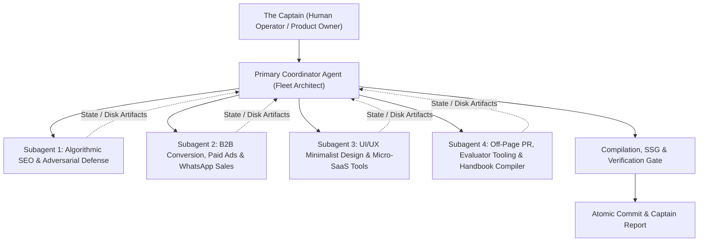

# 08: AUTONOMOUS FLEET ORCHESTRATION & SUBAGENT PROTOCOLS
## The Engineering Handbook for Multi-Agent Task Decomposition, Git Worktree Isolation & Distributed Fleet Concurrency

---

## 1. Executive Overview

When building, auditing, or scaling large enterprise digital architectures, programmatic SEO engines (indexing thousands of URLs), or multi-channel conversion funnels, a single linear LLM context window becomes an operational bottleneck. Attempting to execute an entire enterprise roadmap in a single prompt causes:
1. **Context Window Degradation:** Attention dilution and hallucinated file references as the context exceeds 60,000 tokens.
2. **Truncated Generation Outputs:** Incomplete file writes, syntax errors, and missing closing brackets.
3. **Cognitive Domain Collisions:** An agent attempting to be an unsparing Google Navboost database auditor and a minimalist CSS designer in the same turn produces mediocre compromises.

The architectural solution is **Autonomous Multi-Agent Fleet Orchestration**: decomposing complex digital objectives into specialized, parallel subagent workstreams governed by an uncompromising Primary Coordinator.

This handbook establishes the exact architectural rules, communication contracts, git worktree isolation boundaries, POSIX lockfile management, and verification gates required to deploy fleets of AI agents that deliver flawless, production-grade results without collision.

---

## 2. Multi-Agent Topology & Hierarchy



### 2.1 The Two-Tier Agent Architecture
1. **The Primary Coordinator (First Mate / Fleet Architect):**
   - The single point of contact for the human user (Captain).
   - Holds the master project state, file registry, and dependency graph.
   - Decomposes high-level mandates into granular, self-contained subagent briefs.
   - Monitors subagent progress, reconciles disk state, and runs global integration tests (`npx tsc`, `npm run build`, SSG validation).
   - Never delegates global git commits or captain-level reporting to subagents.

2. **The Worker Subagents (Specialized Crewmates):**
   - Autonomous LLM instances spawned with a focused, single-domain persona (e.g. "TypeScript Refactoring Specialist", "Google Navboost Auditor", "Anti-AI Slop Copywriter").
   - Strictly bounded scope: Each subagent is assigned a distinct set of files, directories, or research questions.
   - Never attempt to communicate directly with the human operator; all findings, code, and errors flow back through the Primary Coordinator or disk artifacts.

---

## 3. The 6 Laws of Subagent Isolation & Concurrency

To prevent race conditions, file corruption, and conflicting edits when multiple AI agents work on the same repository simultaneously, every fleet must adhere to these six laws:

### Law 1: Non-Overlapping File Write Boundaries
No two subagents may ever be assigned write permissions to the same file during the same execution turn.
- Subagent A edits `frontend/src/components/pages/SolutionDetail.tsx`.
- Subagent B edits `automation/compact_landing_generator.py`.
- Subagent C authors `MASTER_AGENT_PLAYBOOK/01_SEARCH_ENGINE_DOMINATION_ALGORITHMIC_BLUEPRINT.md`.
If two tasks touch the same file, the Primary Coordinator must sequence them linearly or handle the merge directly.

### Law 2: Git Worktree Isolation for Deep Refactors
For complex, multi-file code modifications where subagents might alter shared node modules or build directories, the Primary Coordinator must spin up isolated **Git Worktrees**:
```bash
# Create an isolated worktree for Subagent 2
git worktree add -b agent-bofu-overhaul .worktrees/subagent-2 main
```
This grants the subagent a clean, dedicated filesystem branch where builds and tests can execute without interfering with the parent workspace. Upon verification, the Coordinator merges the branch back cleanly:
```bash
git merge --no-ff agent-bofu-overhaul
git worktree remove .worktrees/subagent-2
```

### Law 3: POSIX Lockfile State Serialization
Agents must never rely on ephemeral memory or implicit assumptions across subagent boundaries. All state transfers must occur via structured files on disk protected by advisory lockfiles:
- Research findings $\rightarrow$ Markdown reports in `docs/`, `artifacts/`, or `automation/`
- Queue data $\rightarrow$ Structured JSON files (e.g., `automation/keywords_queue.json`)
- Runtime signals $\rightarrow$ Append-only status logs with `.lock` serialization (`state/<id>.status.lock`)

### Law 4: Zero-Assumption Tool Invocation
A subagent must never assume a command, package, or directory exists without checking.
- Before running `python3 script.py`, confirm python3 is installed and the file path is valid.
- Before editing a component, read the exact file contents to get accurate line numbers and context.

### Law 5: Strict Pre-Merge Verification Gates
A subagent's work is considered incomplete until it has passed all domain-specific quality gates:
1. **Compilation Gate:** `npx tsc -p frontend/tsconfig.json --noEmit` returns **0 errors**.
2. **Build Gate:** `npm run build` succeeds cleanly.
3. **SSG Pre-Render Gate:** Pre-rendering generates valid HTML DOM for all routes.
4. **Copywriting Gate:** Zero banned AI words in generated text.

### Law 6: Fail-Safe Recovery & Termination
If a subagent enters an infinite loop, hallucinates invalid dependencies, or stalls, the Primary Coordinator must terminate the subagent, inspect the partial disk artifacts, revert invalid edits, and either re-prompt with tighter constraints or complete the task directly.

---

## 4. Subagent Briefing & Prompt Construction Standards

A poorly briefed subagent will inevitably drift, hallucinate, or write generic boilerplate. Every subagent briefing generated by the Primary Coordinator must include the following 6 structural sections:

```markdown
# SUBAGENT OPERATIONAL BRIEF
## 1. Role & Identity
[Exact specialized job title, e.g., "Elite TypeScript & CSS Systems Engineer"]

## 2. Working Directory & Absolute Boundaries
- Work Directory: `/path/to/project`
- Permitted Files to Edit/Create: `[Exact file list]`
- Strictly Prohibited Areas: `[Files that must not be touched]`

## 3. The Exact Mandate
[Clear, unambiguous, first-principles task description with specific inputs and outputs]

## 4. Quantitative Constraints & Design System Rules
- Visual: Monochrome black/white, Inter font, rounded-3xl cards, rounded-full pills, no empty 128px gaps.
- Copy: Zero AI slop, 70% adjective reduction, plain-spoken engineering tone, WhatsApp CTA primary.
- SEO: Moz 96-98 sweet spot, tri-alignment integrity, 400-550 words.

## 5. Verification Instructions
[Exact command to execute to prove the work is correct, e.g. `npx tsc --noEmit`]

## 6. Required Deliverable & Output Format
[Summary of modified files, terminal test outputs, and line-level changes]
```

---

## 5. Production Python Automation Scripts for Fleet Management

To orchestrate fleets programmatically across local environments or CI/CD pipelines, use the following production-grade patterns:

### 5.1 Async Multi-Agent Process Queue (`fleet_orchestrator.py`)
```python
"""
ELESIUM FLEET ASYNC ORCHESTRATOR
Spawns, monitors, and verifies parallel subagent execution with concurrency control.
"""

import asyncio
import os
import subprocess
import time
from typing import List, Dict

MAX_CONCURRENT_AGENTS = 4
STATE_DIR = "state"
os.makedirs(STATE_DIR, exist_ok=True)

class SubagentTask:
    def __init__(self, agent_id: str, role: str, command: List[str]):
        self.agent_id = agent_id
        self.role = role
        self.command = command
        self.status = "PENDING"
        self.start_time = 0.0
        self.end_time = 0.0

async def execute_subagent(task: SubagentTask, semaphore: asyncio.Semaphore) -> bool:
    async with semaphore:
        task.status = "RUNNING"
        task.start_time = time.time()
        print(f"[*] [LAUNCH] Agent {task.agent_id} ({task.role})...")
        
        proc = await asyncio.create_subprocess_exec(
            *task.command,
            stdout=asyncio.subprocess.PIPE,
            stderr=asyncio.subprocess.PIPE
        )
        stdout, stderr = await proc.communicate()
        task.end_time = time.time()
        
        duration = round(task.end_time - task.start_time, 2)
        if proc.returncode == 0:
            task.status = "SUCCESS"
            print(f"[+] [COMPLETED] Agent {task.agent_id} in {duration}s")
            return True
        else:
            task.status = "FAILED"
            print(f"[!] [FAILED] Agent {task.agent_id} ({duration}s):\n{stderr.decode()}")
            return False

async def run_fleet(tasks: List[SubagentTask]):
    semaphore = asyncio.Semaphore(MAX_CONCURRENT_AGENTS)
    results = await asyncio.gather(*[execute_subagent(t, semaphore) for t in tasks])
    success_rate = (sum(results) / len(results)) * 100
    print(f"\n==========================================")
    print(f"Fleet Execution Complete. Success Rate: {success_rate:.1f}%")
    print(f"==========================================")
```

### 5.2 Pre-Merge Verification Runner (`verify_fleet_health.py`)
```python
import subprocess
import sys

def run_gate(name: str, cmd: list) -> bool:
    print(f"[*] Running Gate: {name}...")
    result = subprocess.run(cmd, capture_output=True, text=True)
    if result.returncode != 0:
        print(f"[!] FAILED: {name}")
        print(result.stdout)
        print(result.stderr)
        return False
    print(f"[+] PASSED: {name}")
    return True

def main():
    gates = [
        ("TypeScript Static Type Check", ["npx", "tsc", "-p", "frontend/tsconfig.json", "--noEmit"]),
        ("Vite Production Bundle Build", ["npm", "--prefix", "frontend", "run", "build"]),
        ("Sitemap Structure & Size Check", ["python3", "automation/generate_sitemap.py"]),
    ]
    
    for name, cmd in gates:
        if not run_gate(name, cmd):
            sys.exit(1)
            
    print("\n[SUCCESS] All fleet quality gates passed. Repository is 100% production ready.")

if __name__ == "__main__":
    main()
```

---

## 6. Fleet Audit Checklist for the Primary Coordinator

Before declaring any multi-agent mission complete and reporting to the Captain, the Primary Coordinator must verify each item on this checklist:

- [ ] **No Orphan Subagents:** All spawned subagents have completed their tasks or been safely terminated.
- [ ] **No Uncommitted Merge Conflicts:** Git status shows clean modifications with zero unresolved conflict markers (`<<<<<<<`).
- [ ] **Zero TypeScript Errors:** `npx tsc --noEmit` produces 0 errors.
- [ ] **Zero Hydration Mismatches:** SSG pre-rendered HTML matches the React client-side tree.
- [ ] **Design System Integrity:** No random gradients, no missing borders, no 128px vertical voids, all cards use `rounded-3xl`, all buttons use `rounded-full`.
- [ ] **Pure WhatsApp Funnel:** Every single primary CTA links directly to `https://wa.me/918317329312`.
- [ ] **Documentation Completeness:** All newly created code, tools, or data structures are fully documented in the playbook and project README.
