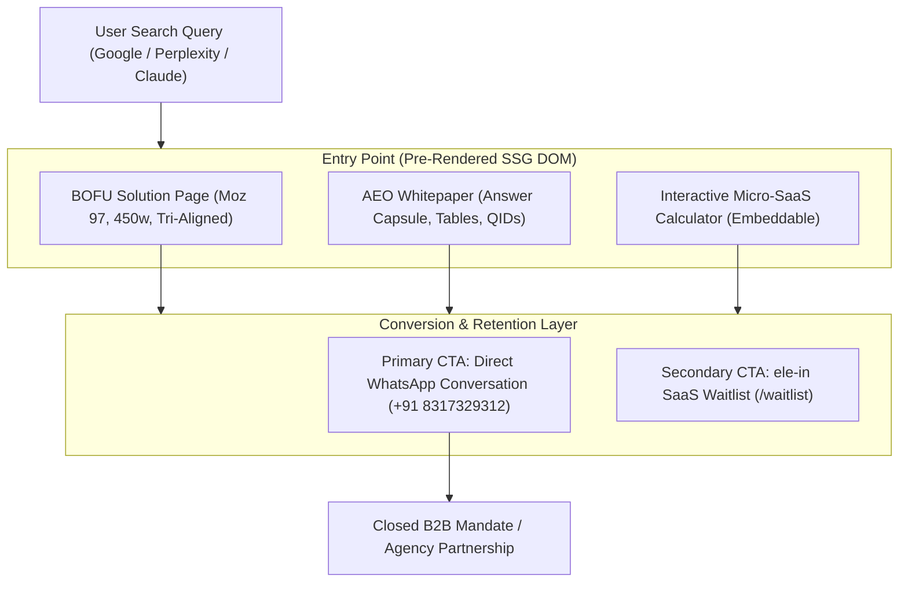

# MASTER AGENT PLAYBOOK
## The Autonomous AI Operating System for Inevitable Search Domination & Enterprise Conversion

```
       ███████╗██╗     ███████╗███████╗██╗██╗   ██╗███╗   ███╗
       ██╔════╝██║     ██╔════╝██╔════╝██║██║   ██║████╗ ████║
       █████╗  ██║     █████╗  ███████╗██║██║   ██║██╔████╔██║
       ██╔══╝  ██║     ██╔══╝  ╚════██║██║██║   ██║██║╚██╔╝██║
       ███████╗███████╗███████╗███████║██║╚██████╔╝██║ ╚═╝ ██║
       ╚══════╝╚══════╝╚══════╝╚══════╝╚═╝ ╚═════╝ ╚═╝     ╚═╝
             AUTONOMOUS AGENT DOMINATION SYSTEM | V2026.1
```

---

## 1. Directory Overview & System Mission

Welcome to the **Master Agent Playbook**. This directory is a self-contained, modular, production-grade operating system designed to direct any artificial intelligence (Claude 3.7 / Opus, ChatGPT-4o / o1 / o3, Gemini 1.5 / 2.0 Pro, DeepSeek-R1, or open-source agent frameworks) to build, optimize, and scale digital properties that **inevitably capture the #1 position on search engines and convert cold B2B traffic at maximum velocity**.

No theory. No generic advice. Every file in this playbook contains concrete mathematical equations, reverse-engineered search engine algorithms, battle-tested CSS and component design rules, de-slopped copywriting formulas, and copy-paste prompt templates.

---

## 2. Master Table of Contents & File Manifest

| File | Module Title | Primary Focus & Domain |
| :--- | :--- | :--- |
| **[`00_MASTER_AGENT_ORCHESTRATION_MANIFEST.md`](./00_MASTER_AGENT_ORCHESTRATION_MANIFEST.md)** | The AI Agent Constitution | Prime directives, first-principles thinking, zero-assumption verification, error handling, and behavioral calibration. |
| **[`01_SEARCH_ENGINE_DOMINATION_ALGORITHMIC_BLUEPRINT.md`](./01_SEARCH_ENGINE_DOMINATION_ALGORITHMIC_BLUEPRINT.md)** | Algorithmic Search Domination | Google Navboost telemetry, Twiddler post-retrieval reranking, Information Gain patent (US 10,754,904 B2), Scaled Content Abuse defense, and Striking Distance boosting. |
| **[`02_ANSWER_ENGINE_OPTIMIZATION_AND_GEO_TACTICS.md`](./02_ANSWER_ENGINE_OPTIMIZATION_AND_GEO_TACTICS.md)** | AEO & GEO Tactics | Princeton & Georgia Tech GEO study benchmarks, the 6-Gate AEO Framework, 42-48 word Answer Capsules, Wikidata QIDs, and schema injection. |
| **[`03_BOFU_HIGH_CONVERTING_LANDING_PAGES_BIBLE.md`](./03_BOFU_HIGH_CONVERTING_LANDING_PAGES_BIBLE.md)** | BOFU Landing Pages Bible | Edward Sturm Compact SEO, tri-alignment integrity (Slug, Title, H1), Moz 96–98 sweet spot, 400-550 word count gate, and mobile geometry. |
| **[`04_COPYWRITING_AND_ANTI_AI_SLOP_HUMANIZATION_GUIDE.md`](./04_COPYWRITING_AND_ANTI_AI_SLOP_HUMANIZATION_GUIDE.md)** | Anti-AI Slop Copywriting Guide | Banned AI words dictionary, 70% adjective reduction formula, Stripe/AWS plain-spoken engineering voice, and high-converting B2B ad/email copy. |
| **[`05_UI_UX_DESIGN_SYSTEM_AND_CONVERSION_FUNNEL_STANDARDS.md`](./05_UI_UX_DESIGN_SYSTEM_AND_CONVERSION_FUNNEL_STANDARDS.md)** | UI/UX & Conversion Funnel | Minimalist monochrome black & white design system, Inter typography, `rounded-3xl` cards, `rounded-full` pills, zero dead voids, and pure WhatsApp funnel. |
| **[`06_INTERACTIVE_TOOLS_AND_LINKABLE_ASSET_ENGINEERING.md`](./06_INTERACTIVE_TOOLS_AND_LINKABLE_ASSET_ENGINEERING.md)** | Interactive Linkable Assets | Micro-SaaS calculators, real-time reactive math, viral iframe embed engine with permanent watermark backlinks, and executive memo generators. |
| **[`07_PR_SYNDICATION_DIRECTORY_AND_OFFPAGE_AUTHORITY_STACKING.md`](./07_PR_SYNDICATION_DIRECTORY_AND_OFFPAGE_AUTHORITY_STACKING.md)** | Off-Page Authority Stacking | 100% NAP consistency, Clutch/GoodFirms/G2 directory dominance, 1-3 sentence journalist query pitching (Connectively/Featured), and Meetup takeovers. |
| **[`08_AUTONOMOUS_FLEET_ORCHESTRATION_AND_SUBAGENT_PROTOCOLS.md`](./08_AUTONOMOUS_FLEET_ORCHESTRATION_AND_SUBAGENT_PROTOCOLS.md)** | Multi-Agent Fleet Protocols | Subagent task decomposition, non-overlapping file isolation, disk serialization, TypeScript verification gates, and atomic deployment rules. |
| **[`09_CHEAT_CODES_PROMPT_TEMPLATES_AND_SYSTEM_PROMPTS.md`](./09_CHEAT_CODES_PROMPT_TEMPLATES_AND_SYSTEM_PROMPTS.md)** | Turnkey System Prompts | Copy-paste master system prompts for Claude, ChatGPT, Gemini, and DeepSeek, execution templates for keywords/pages/whitepapers, and recovery matrix. |

---

## 3. How to Inject This Playbook into Any AI Model

### For Claude (Claude 3.7 Sonnet / Opus / Projects)
1. Upload the entire `MASTER_AGENT_PLAYBOOK/` folder or paste `00_MASTER_AGENT_ORCHESTRATION_MANIFEST.md` into Project Knowledge.
2. In the System Instructions / Custom Prompt, paste the Claude Master Prompt found in [`09_CHEAT_CODES_PROMPT_TEMPLATES_AND_SYSTEM_PROMPTS.md`](./09_CHEAT_CODES_PROMPT_TEMPLATES_AND_SYSTEM_PROMPTS.md).

### For ChatGPT (GPT-4o / o1 / Custom GPTs)
1. Add these markdown files to the Custom GPT Knowledge store.
2. Paste the ChatGPT Master Instructions from File 09 into the Instructions field. Ensure Code Interpreter is enabled.

### For Gemini (Gemini 1.5 Pro / 2.0 Pro / Google AI Studio)
1. In Google AI Studio, upload the files as context documents or set them as System Instructions.
2. Set Temperature to `0.2` to ensure strict mathematical adherence and zero stylistic drift.

### For Autonomous Coding Agents (Antigravity, Cursor, Aider, Codex)
1. Add `MASTER_AGENT_PLAYBOOK/` to the repository root.
2. Reference specific modules in your prompt (e.g. `@MASTER_AGENT_PLAYBOOK/05_UI_UX_DESIGN_SYSTEM_AND_CONVERSION_FUNNEL_STANDARDS.md`).

---

## 4. The 3 Immutable Quality Gates

Before any AI agent is permitted to consider a task finished, it must pass these three verification gates:

```
[GATE 1: CODE INTEGRITY]
npx tsc -p frontend/tsconfig.json --noEmit  ===>  0 ERRORS
npm run build                                ===>  CLEAN BUNDLE

[GATE 2: COPYWRITING INTEGRITY]
python3 automation/deslop_content.py        ===>  0 BANNED AI WORDS
                                             ===>  < 15% ADJECTIVE DENSITY

[GATE 3: CONVERSION & DESIGN INTEGRITY]
Primary CTA Check                            ===>  100% WHATSAPP (wa.me/918317329312)
Secondary Waitlist Check                     ===>  ISOLATED TO /waitlist (ele-in SaaS)
Geometry Check                               ===>  rounded-3xl CARDS / rounded-full PILLS
```

---

## 5. Architectural Flow & Funnel Hierarchy



---

*Authored by the Elesium Fleet Intelligence Core. Designed for relentless execution and permanent market leadership.*
