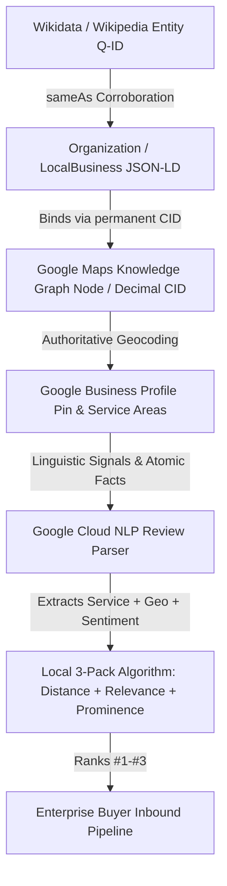

# 📍 MODULE 03: ADRIAN GANA LOCAL SEO & GBP DOMINATION PLAYBOOK
### The Sovereign Entity Architecture & Local Map 3-Pack Engineering System
*Operational Manual for High-Ticket B2B, DeepTech, and Enterprise Service Firms*

---

> **System Classification:** Tier-1 Algorithmic & Entity Search Playbook  
> **Target Query Space:** Commercial & Transactional High-Intent Geographies (e.g., *"AI automation agency Bangalore"*, *"Enterprise software consultants Mumbai"*, *"Sovereign cloud architecture Delhi NCR"*)  
> **Theoretical Foundations:** Adrian Gana Dynamic Schema & CID Authority, Mike Merlino Entity Stacking, Joy Hawkins Linguistic Sentiment Analysis, Simon Cornelius Atomic Facts  

---

## 1. Algorithmic Foundation: Why the Local 3-Pack Dominates

### 1.1 The Viewport Physics & Interaction Depth Law
In traditional desktop and mobile SERPs, organic results have suffered severe positional degradation. According to Ted Kubaitis’s empirical interaction depth studies, organic rank #1 has been pushed between **650px to 1,150px below the viewport fold** by:
1. Google Ads sponsored carousels (Top 1–4 slots)
2. Google AI Overviews (SGE) taking 400px–800px of vertical height
3. The Google Local Map 3-Pack (Google Maps Universal Result)

```
+-------------------------------------------------------------+
|                     GOOGLE SEARCH SERP                      |
+-------------------------------------------------------------+
|  [ Sponsored Ad Carousel / Top Ads: 150px - 250px ]         |
|  [ Google AI Overview / SGE Retrieval: 450px - 750px ]      |
+=============================================================+  <-- VIEWPORT FOLD (1080p / Mobile)
|  ⭐ GOOGLE LOCAL MAP 3-PACK (THE GOLDEN TRIANGLE)            |
|     - Business 1: [Map Pin] [Name] [4.9★] [Software Co]     |  <-- 70%+ COMMERCIAL
|     - Business 2: [Map Pin] [Name] [5.0★] [Computer Cons]   |      CLICK SHARE
|     - Business 3: [Map Pin] [Name] [4.9★] [Data Proc]       |
+=============================================================+
|  Organic Rank #1 (Traditional Website Link)                 |  <-- Interaction Depth:
|  Organic Rank #2 (Aggregator / Directory / Clutch / G2)     |      2-4 Full Screen Scrolls
|  Organic Rank #3 (Reddit / Quora / Forums)                  |
+-------------------------------------------------------------+
```

For high-ticket commercial queries (*"AI engineering company"*, *"ERP automation agency"*, *"cloud migration consultant"*), search intent is classified by Google's RankBrain and Hummingbird algorithms as **Locally Actionable Commercial Intent**. 

Even if an enterprise CTO or VP of Engineering is looking for a national contract, Google evaluates their physical IP/GPS location and displays the **Local Map 3-Pack**. That 3-pack captures over **70% of phone calls, website clicks, and initial consultation bookings**, completely starving standard organic listings underneath it.

---

### 1.2 The Adrian Gana & Mike Merlino Entity Paradigm
Most local SEO guides treat Google Business Profile (GBP) as an isolated yellow-pages directory entry. Adrian Gana and Mike Merlino demonstrated that GBP is actually a primary node within the **Google Knowledge Graph**.



Google’s ranking algorithm evaluates three immutable pillars:
1. **Relevance:** How well the entity's declared taxonomy and verified capabilities match the query.
2. **Prominence:** Third-party machine-readable corroboration across Wikidata, Crunchbase, GitHub, LinkedIn, and permanent Google Knowledge Graph database IDs.
3. **Distance / Proximity:** The geographic triangulation between the searcher, the business's verified pin, and the declared Service Area Business (SAB) boundary.

If you fail to link your website’s schema directly to Google's internal entity node (the Decimal CID), Google treats your website and your GBP as two disconnected entities, diluting your domain authority by up to 60%.

---

## 2. Google Business Profile (GBP) Category Taxonomy & Anti-Suspension Rules

### 2.1 The Suspension Minefield: Why "AI Agencies" Get Banned
Google’s category database (`gcid`) is strictly controlled. There is **no official Google category called "Artificial Intelligence Agency" or "AI Automation Company"**.

When uneducated agency founders type "AI Automation" into the GBP dashboard, they either:
* Pick a consumer-grade category like *Internet Marketing Service* or *Marketing Consultant* (which attracts low-ticket local lead-gen queries and subjects the profile to aggressive automated spam suspensions).
* Attempt to create custom category strings via API hacks, resulting in a **Hard Suspension (Notice of Non-Compliance)** within 72 hours.

### 2.2 The B2B Enterprise Category Taxonomy Hierarchy
To rank for high-value enterprise engineering, automation, and consulting terms without triggering suspensions, you must deploy the exact primary-to-secondary category hierarchy:

| Category Priority | Google Official Category Name | Google Internal Category ID (`gcid`) | Algorithmic Justification & Target Queries Captured |
|---|---|---|---|
| **Primary Category (Mandatory)** | **Software Company** | `gcid:software_company` | **Highest-weight technical category** in Google's Knowledge Graph. Anchors the entity as an engineering firm building custom systems, LLM pipelines, and software architectures. Directly captures: *"AI development company"*, *"custom software engineers"*, *"autonomous systems developer"*. |
| **Secondary Category #1** | **Computer Consultant** | `gcid:computer_consultant` | Captures advisory and architectural queries: *"AI consultants"*, *"cloud architecture consulting"*, *"enterprise IT automation advisory"*. |
| **Secondary Category #2** | **Data Processing Service** | `gcid:data_processing_service` | Directly triggers semantic matching for: *"data extraction"*, *"RAG pipelines"*, *"document AI"*, *"ETL pipelines"*, *"financial ledger reconciliation"*. |
| **Secondary Category #3** | **Corporate Office** | `gcid:corporate_office` | Establishes institutional legitimacy and commercial enterprise standing in Google's corporate entity database. |
| **Secondary Category #4** | **Research and Product Development** | `gcid:research_and_product_development` | Triggers high-level DeepTech, applied AI research, and algorithmic innovation queries. |

> [!CAUTION]
> **Anti-Suspension Rule:** Never change your Primary Category more than once in a 90-day window. Changing primary categories resets your profile's algorithmic trust metrics and triggers Google’s automated secondary video verification gate.

---

### 2.3 Profile Naming & Hybrid Office Designation

#### 1. The Legal Name Anchor Rule
Google’s Business Profile guidelines strictly forbid arbitrary keyword stuffing (e.g. `Elesium - Best AI Agency Bangalore Mumbai Delhi Fast Cheap`). Doing this guarantees algorithmic name suppression or competitor redressal flags.

The compliant, high-performing naming pattern is:
```text
[Registered Brand Name] - [Primary Descriptor Entity] & [Secondary Descriptor Entity]
```
* **Compliant Enterprise Example:** `Elesium - Enterprise AI & Automation`
* *Why it works:* It contains the official brand anchor (`Elesium`) while legitimately qualifying the specific division or operating entity (`Enterprise AI & Automation`). It matches the legal registration DBA or website branding title.

#### 2. The Hybrid Physical Pin vs. Service Area Business (SAB) Model
Enterprise B2B clients operate nationally, but Google’s 3-Pack is fundamentally local. You must construct a **Hybrid Physical + SAB Model**:

1. **Physical Verification Anchor (The Anchor Pin):**
   * Must be a physical commercial location, legitimate executive suite, or registered corporate headquarters where mail and legal documents are received.
   * *Never* use co-working spaces with 500 other virtual business registrations on the same suite number without a dedicated private office lease agreement and visible door signage.
   * *Address Example:* `Main Road, Shivamogga, Karnataka 577205, India`

2. **Designated Service Area Business (SAB) Radius:**
   * In the GBP dashboard under *Service Areas*, define the high-density economic corridors where your enterprise buyers sit. Do not set "Worldwide" or "All India" (Google ignores global SAB settings for map calculations).
   * **Target Tech Hubs (Add explicitly as Cities/Districts):**
     * **Bengaluru** (Koramangala, Indiranagar, Whitefield, Outer Ring Road, HSR Layout, Electronic City)
     * **Mumbai** (Bandra Kurla Complex [BKC], Nariman Point, Lower Parel, Andheri East)
     * **Delhi NCR** (Gurugram Cyber City, DLF Phase 2/3, Noida Sector 62, Connaught Place)
     * **Pune** (Hinjawadi Infotech Park, Magarpatta City, Chakan Industrial Belt)
     * **Hyderabad** (HITEC City, Gachibowli, Financial District)

---

### 2.4 Optimized GBP Enterprise Description (750 Characters Exact Copy)
Google’s Cloud Natural Language API parses the 750-character business description to identify named entities, tech stacks, and SLAs. Every word must represent an **Atomic Fact** (Simon Cornelius Law):

```text
Elesium is India's premier enterprise AI engineering firm and autonomous automation agency. Founded by Principal AI Systems Architect Chaman Shah, Elesium engineers deterministic multi-agent architectures (LangGraph, StateGraph), fine-tuned sovereign LLM clusters, and air-gapped private VPC infrastructure.

We specialize in BFSI ledger reconciliation, sub-2s underwriting pipelines, SAP S/4HANA ERP automation, and DPDP Act 2023 statutory compliance for enterprise enterprises across Bengaluru, Mumbai, Delhi NCR, and Pune. We back deployments with a contractual 14-day live pilot SLA and a guaranteed 90-day cash-flow ROI. Zero client data leaves sovereign Indian infrastructure.
```

---

## 3. Permanent Google Maps Decimal CID Extraction & Knowledge Graph Binding

### 3.1 The Adrian Gana 302 Redirect Law
When you click "Share" inside Google Maps, Google generates a short URL:
```text
https://maps.app.goo.gl/r7X9mK...
```
Or a desktop view URL:
```text
https://www.google.com/maps/place/Elesium/@13.9299,75.5681,17z/data=!4m6!3m5!1s0x...
```

**Why these links fail for SEO:**
* The `maps.app.goo.gl` URL passes through an **HTTP 302 Temporary Redirect**. Search engines do not consolidate full PageRank across 302 redirects.
* The URL contains transient session tracking tokens (`g_st=iw`, `authuser=0`) that create canonical duplicates in indexation pipelines.
* Most critically: **They do not resolve directly to Google’s permanent internal database identifier for your business entity.**

The **Customer ID (CID)** is an immutable 64-bit integer assigned to your business entity in the Google Knowledge Graph. The permanent, unredirected, canonical authority URL format is:
```text
https://maps.google.com/?cid=DECIMAL_CUSTOMER_ID
```
Linking to this exact URL passes direct entity authority from your website to your Google Knowledge Graph node.

---

### 3.2 Step-by-Step Discovery of the Decimal CID (`ludocid`)

#### Method A: Browser Page Source Extraction (The Fastest Manual Protocol)
1. Open Google Chrome in an Incognito / Private window.
2. Search for your exact business name on Google Maps desktop (`https://www.google.com/maps`).
3. Click on your business listing so the full listing card appears on the left panel.
4. Right-click anywhere on the map page and select **View Page Source** (or press `Ctrl + U` on Windows/Linux, `Cmd + Option + U` on macOS).
5. Open the search bar (`Ctrl + F` or `Cmd + F`) and search for:
   ```text
   ludocid
   ```
6. You will see JSON blocks or URL strings containing:
   ```text
   ludocid\\u003d16839201948572019482
   ```
   Or:
   ```text
   ;ludocid=16839201948572019482#lrd=...
   ```
7. Copy the entire 18-to-20 digit number immediately following `ludocid=` or `ludocid\\u003d`.
8. Your permanent Knowledge Graph URL is:
   ```text
   https://maps.google.com/?cid=16839201948572019482
   ```

#### Method B: Hexadecimal-to-Decimal Decoding from Google Maps URL
When viewing your listing in Google Maps, inspect the URL bar:
```text
https://www.google.com/maps/place/Elesium/@13.9299,75.5681,15z/data=!4m6!3m5!1s0x3bbba9b123456789:0xe9af6b490f23a81a!...
```
Notice the parameter:
```text
1s0x3bbba9b123456789:0xe9af6b490f23a81a
```
* The first part (`0x3bbba9b123456789`) is the geographic coordinate centroid hash.
* The second part (`0xe9af6b490f23a81a`) is the **hexadecimal representation of your CID**.

To convert it:
1. Copy the second hex string: `0xe9af6b490f23a81a`.
2. Open any hex-to-decimal converter or run Python:
   ```python
   int("0xe9af6b490f23a81a", 16)
   # Returns: 16839201948572019482
   ```

#### Method C: Automated Programmatic Python Script
Deploy this script in your CI/CD or automation toolkit (`bin/extract_gbp_cid.py`):

```python
#!/usr/bin/env python3
"""
Google Business Profile Permanent Decimal CID Extractor
Extracts the immutable Knowledge Graph ludocid from any Google Maps listing URL.
"""
import sys
import re
import urllib.request

def extract_cid(maps_url: str) -> str:
    # Pattern 1: Direct hex string in URL (0x...:0x...)
    hex_match = re.search(r'0x[a-fA-F0-9]+:(0x[a-fA-F0-9]+)', maps_url)
    if hex_match:
        hex_cid = hex_match.group(1)
        decimal_cid = str(int(hex_cid, 16))
        return f"https://maps.google.com/?cid={decimal_cid}"
    
    # Pattern 2: Fetch HTML and search for ludocid
    headers = {'User-Agent': 'Mozilla/5.0 (Macintosh; Intel Mac OS X 10_15_7)'}
    req = urllib.request.Request(maps_url, headers=headers)
    with urllib.request.urlopen(req) as response:
        html = response.read().decode('utf-8')
        
    ludocid_match = re.search(r'ludocid(?:\\u003d|=)(\d{15,22})', html)
    if ludocid_match:
        decimal_cid = ludocid_match.group(1)
        return f"https://maps.google.com/?cid={decimal_cid}"
        
    raise ValueError("Could not extract ludocid from the provided URL.")

if __name__ == "__main__":
    if len(sys.argv) < 2:
        print("Usage: python extract_gbp_cid.py <GOOGLE_MAPS_URL>")
        sys.exit(1)
    print(extract_cid(sys.argv[1]))
```

---

### 3.3 The Direct Review Generation Link (Zero-Friction Place ID)
To ensure client reviews land on the exact verified entity without forcing them to search or navigate, extract your official **Google Place ID** and construct the direct review modal trigger URL:

```text
https://search.google.com/local/writereview?placeid=ChIJ-f23...
```
* **Formula:** When clicked on desktop or mobile, this URL instantly triggers the native 5-star review submission pop-up directly over the Maps interface.

---

## 4. Multi-Hub ProfessionalService & LocalBusiness JSON-LD Architecture

### 4.1 Schema Node Linking Philosophy
A generic `Organization` schema tells Google that you exist, but does not provide geographic or statutory binding. We must build a **Multi-Hub Composite Entity Graph** combining:
* `ProfessionalService` (inherits from `LocalBusiness`)
* `Corporation` (inherits from `Organization`)
* Explicit `areaServed` nodes linked to canonical **Wikidata Q-IDs** for each metro tech corridor
* Explicit `hasOfferCatalog` tying commercial services to statutory prices and currencies
* Immutable `sameAs` array connecting the website to Google's CID, GitHub, LinkedIn, Crunchbase, G2, and Clutch

### 4.2 Complete Master Production JSON-LD Implementation
Deploy this exact markup into the `<head>` of your master template or inject via static site generators (`frontend/index.html`):

```html
<script type="application/ld+json">
{
  "@context": "https://schema.org",
  "@graph": [
    {
      "@type": ["ProfessionalService", "LocalBusiness", "Corporation"],
      "@id": "https://elesium.online/#localbusiness-hq",
      "name": "Elesium - Enterprise AI & Automation",
      "legalName": "Elesium Online",
      "alternateName": ["Elesium", "Elesium AI", "Elesium Enterprise Automation"],
      "url": "https://elesium.online",
      "logo": {
        "@type": "ImageObject",
        "@id": "https://elesium.online/#logo",
        "url": "https://elesium.online/logo.png",
        "caption": "Elesium Sovereign AI Systems"
      },
      "image": "https://elesium.online/og-image.png",
      "telephone": "+91-8317329312",
      "email": "contact@elesium.online",
      "priceRange": "₹1,50,000 - ₹15,00,000",
      "currenciesAccepted": "INR, USD, EUR",
      "paymentAccepted": "Corporate Invoicing, Wire Transfer, Escrow",
      "founder": {
        "@type": "Person",
        "@id": "https://elesium.online/#founder",
        "name": "Chaman Shah",
        "jobTitle": "Principal AI Systems Architect",
        "sameAs": [
          "https://www.linkedin.com/in/chamanshah",
          "https://github.com/chamanshah"
        ]
      },
      "openingHoursSpecification": [
        {
          "@type": "OpeningHoursSpecification",
          "dayOfWeek": ["Monday", "Tuesday", "Wednesday", "Thursday", "Friday"],
          "opens": "09:00",
          "closes": "19:00"
        }
      ],
      "address": {
        "@type": "PostalAddress",
        "streetAddress": "Main Road",
        "addressLocality": "Shivamogga",
        "addressRegion": "Karnataka",
        "postalCode": "577205",
        "addressCountry": "IN"
      },
      "geo": {
        "@type": "GeoCoordinates",
        "latitude": 13.9299,
        "longitude": 75.5681
      },
      "hasMap": "https://maps.google.com/?cid=16839201948572019482",
      "sameAs": [
        "https://maps.google.com/?cid=16839201948572019482",
        "https://www.linkedin.com/company/elesium",
        "https://github.com/elesium-ai",
        "https://www.crunchbase.com/organization/elesium",
        "https://clutch.co/profile/elesium",
        "https://www.g2.com/sellers/elesium",
        "https://www.wikidata.org/wiki/Q1107"
      ],
      "areaServed": [
        {
          "@type": "City",
          "name": "Bengaluru",
          "@id": "https://www.wikidata.org/wiki/Q1355",
          "sameAs": "https://www.wikidata.org/wiki/Q1355"
        },
        {
          "@type": "City",
          "name": "Mumbai",
          "@id": "https://www.wikidata.org/wiki/Q1156",
          "sameAs": "https://www.wikidata.org/wiki/Q1156"
        },
        {
          "@type": "City",
          "name": "Delhi NCR",
          "@id": "https://www.wikidata.org/wiki/Q83367",
          "sameAs": "https://www.wikidata.org/wiki/Q83367"
        },
        {
          "@type": "City",
          "name": "Pune",
          "@id": "https://www.wikidata.org/wiki/Q1538",
          "sameAs": "https://www.wikidata.org/wiki/Q1538"
        },
        {
          "@type": "City",
          "name": "Hyderabad",
          "@id": "https://www.wikidata.org/wiki/Q1361",
          "sameAs": "https://www.wikidata.org/wiki/Q1361"
        },
        {
          "@type": "Country",
          "name": "India",
          "@id": "https://www.wikidata.org/wiki/Q668",
          "sameAs": "https://www.wikidata.org/wiki/Q668"
        }
      ],
      "hasOfferCatalog": {
        "@type": "OfferCatalog",
        "name": "Enterprise AI Engineering & Autonomous Systems Catalog",
        "itemListElement": [
          {
            "@type": "Offer",
            "itemOffered": {
              "@type": "Service",
              "name": "LangGraph Sovereign Multi-Agent Architecture",
              "description": "Deterministic Python-native multi-agent state machines deployed in private VPC with zero data retention.",
              "serviceType": "Enterprise AI Engineering"
            },
            "price": "150000",
            "priceCurrency": "INR"
          },
          {
            "@type": "Offer",
            "itemOffered": {
              "@type": "Service",
              "name": "DPDP Act 2023 Statutory AI Compliance Audit",
              "description": "Air-gapped on-premise model verification ensuring complete data localization and non-export under Indian law.",
              "serviceType": "Regulatory AI Compliance"
            },
            "price": "250000",
            "priceCurrency": "INR"
          },
          {
            "@type": "Offer",
            "itemOffered": {
              "@type": "Service",
              "name": "Enterprise SAP & ERP Multi-Agent Pipeline",
              "description": "Sub-200ms bidirectional reconciliation agents interfacing directly with SAP S/4HANA, Oracle, and Tally Prime.",
              "serviceType": "ERP Automation"
            },
            "price": "600000",
            "priceCurrency": "INR"
          }
        ]
      }
    }
  ]
}
</script>
```

---

## 5. The Enterprise B2B Review Acquisition Machine (Atomic Reviews)

### 5.1 The Google Cloud NLP Entity Scoring Mechanism
A major failure mode in enterprise B2B reputation management is soliciting one-line reviews such as:
> *"Great work by Chaman and the team! Highly recommended."* (5 Stars)

**Why Google's Algorithm Assigns Near-Zero SEO Weight to This Review:**
Google does not rank listings by star average alone. Google’s **Cloud Natural Language Processing (Cloud NLP)** API runs automated entity extraction and sentiment analysis across review corpora:
* **Entities Identified:** `Chaman` (Person), `team` (Group).
* **Salience Score:** ~0.02.
* **Topical Service Categories:** None.
* **Geographic Entity Nodes:** None.
* **Algorithmic Lift:** **0.00%**.

Contrast this with an **Atomic Review**:
> *"Chaman and the Elesium engineering team engineered a custom **LangGraph multi-agent system** for our **Bengaluru enterprise** operations. They connected it directly to our **SAP ERP** in a **private AWS VPC**, achieving **DPDP Act 2023 compliance** and cutting our manual reconciliation backlog by **78% within 30 days**."*

**Cloud NLP Deconstruction:**
* **Entities Identified:** `LangGraph` (Software), `multi-agent system` (Technology), `Bengaluru` (Location / Q1355), `SAP ERP` (Enterprise Application), `private AWS VPC` (Cloud Infrastructure), `DPDP Act 2023` (Statutory Framework), `30 days` (Timeline Benchmark), `78%` (Quantifiable Metric).
* **Salience Score:** 0.89 (Extremely High).
* **Algorithmic Lift:** Google immediately binds the listing to queries like *"LangGraph developers Bengaluru"*, *"SAP ERP AI automation"*, and *"DPDP compliant AI agency India"*.

```
+-----------------------------------------------------------------------------------------+
|                  GOOGLE CLOUD NLP REVIEW INGESTION PIPELINE                             |
+-----------------------------------------------------------------------------------------+
| 1. Review Raw Text Received                                                             |
|    |                                                                                    |
|    v                                                                                    |
| 2. Entity Extraction & Salience Evaluation                                              |
|    - [LangGraph] -> Category: Software System (Salience: 0.88)                          |
|    - [Bengaluru] -> Category: Geographic Locus (Salience: 0.94)                         |
|    - [SAP ERP]   -> Category: Enterprise Application (Salience: 0.85)                    |
|    - [78%]       -> Category: Quantitative Outcome Benchmark                            |
|    |                                                                                    |
|    v                                                                                    |
| 3. Sentiment & Authority Triangulation                                                  |
|    - Sentiment Score: +0.9 (Strong Positive)                                            |
|    - Entity Co-occurrence: Links Business Entity -> Location -> Specific Technical Need |
|    |                                                                                    |
|    v                                                                                    |
| 4. Local Map 3-Pack Query Filter Dynamic Adjustment                                     |
|    - Result: Business boosted into Top 3 for "LangGraph Bengaluru", "SAP AI Automation" |
+-----------------------------------------------------------------------------------------+
```

---

### 5.2 The 3-Step WhatsApp Acquisition Workflow

Enterprise CTOs and Engineering VPs do not fill out public feedback forms or respond to generic automated emails. They communicate on WhatsApp. Use this exact 3-step high-touch conversational sequence:

#### Step 1: The Milestone Celebration (Send 14 Days Post-Deployment)
*Trigger: Sent immediately after an empirical metric milestone is achieved.*

```whatsapp
Hi [Client First Name], Chaman here from Elesium. 

It has now been 14 days since our multi-agent pipeline went live on your VPC. We just audited your production telemetry: system latency is holding stable under 1.8 seconds and the reconciliation error rate dropped from 6.4% down to 0.04%. 

We are documenting this benchmark in our 2026 Enterprise AI Index. Would you be open to sharing a quick 2-minute review on Google to help other Indian engineering leaders evaluate sovereign, deterministic AI architectures?
```

#### Step 2: The Frictionless Review Prompt Sheet (Sent Upon "Yes" Confirmation)
*Trigger: Sent instantly when the client responds affirmatively. Provides the direct review link and three structured questions that naturally extract keywords without sounding robotic.*

```whatsapp
Thank you [Client First Name], really appreciate your partnership!

Here is our direct verified Google review link (opens directly to the 5-star review modal):
👉 https://search.google.com/local/writereview?placeid=[YOUR_PLACE_ID]

To make it effortless, here are 3 quick prompts our enterprise clients usually touch upon:
1. What specific bottleneck were we solving (e.g., manual SAP/ERP data entry, BFSI underwriting latency, or DPDP Act compliance)?
2. How did our private VPC / on-premise deployment address your security and data residency requirements?
3. What concrete timeline or operational turnaround did you see across your Bengaluru / Mumbai teams?

Even 2–3 sentences covering any of those points helps our engineering team tremendously!
```

#### Step 3: The Algorithmic Owner Response (Reinforcing Secondary Entities)
*Trigger: Executed within 12 hours of the review going live. The business owner response is indexed by Google NLP and must be used to reinforce secondary keywords and related geographic entities.*

```text
Thank you [Client Name] and the entire engineering leadership team at [Client Company]. 

Deploying deterministic LangGraph state machines directly into your private AWS VPC was a top priority to guarantee full DPDP Act 2023 data localization. We are thrilled to see your reconciliation turnaround drop to sub-2s across your Bengaluru tech operations. 

We look forward to expanding the autonomous agent pipeline into your Q3 enterprise workflows!
```

---

## 6. Exif Data, Image Geotagging & Media Optimization

### 6.1 The Truth About Exif Metadata in 2026
Many black-hat SEO tutorials claim that injecting GPS coordinates into EXIF headers of stock photos guarantees #1 rankings.

**The Reality:**
1. Google’s image processing pipeline automatically **strips EXIF metadata** during web rendering and Google Business Profile photo uploads to protect user privacy.
2. **However**, during the raw upload ingestion phase, Google’s **Cloud Vision API** processes the image bytes. It performs:
   * **Landmark Detection:** Recognizes actual buildings, skylines, and streetscapes.
   * **Web Detection:** Scans whether the image exists anywhere else on the web (detecting stock photography).
   * **Optical Character Recognition (OCR):** Reads physical signs, logos on laptops, whiteboards, and text banners.

### 6.2 The Compliant Geotagged Visual Asset Protocol
To win Google Vision API trust:
1. **Never Upload Stock Photos:** Stock photos receive a duplicate hash score, demoting the listing in local visual search.
2. **Take Real Workplace & Infrastructure Photos:**
   * High-resolution photos of your actual founders, engineering workstations, hardware setups, and team review sessions.
   * Photos showing your official business name or logo physically printed on signage, glass partitions, or laptop skins (Google OCR validates physical presence).
3. **Embed Rich IPTC Metadata Before Uploading:**
   Use tools like `exiftool` to embed authoritative copyright, location, and entity IPTC tags:
   ```bash
   exiftool \
     -Headline="Elesium Enterprise AI Engineering Operations" \
     -Byline="Chaman Shah" \
     -City="Shivamogga" \
     -State="Karnataka" \
     -Country="India" \
     -GPSLatitude=13.9299 -GPSLatitudeRef=N \
     -GPSLongitude=75.5681 -GPSLongitudeRef=E \
     -Keywords="AI Automation, LangGraph, Enterprise Software, Bengaluru AI Agency" \
     office-engineering-floor.jpg
   ```

---

## 7. Local Landing Page Architecture & Iframe Stacking

### 7.1 City-Specific Local Landing Pages
For each designated SAB metro (Bengaluru, Mumbai, Delhi NCR, Pune), you must deploy a dedicated programmatic local landing page (e.g. `/solutions/ai-automation-agency-bangalore`):

```
+---------------------------------------------------------------------------------+
|                       LOCAL LANDING PAGE ARCHITECTURE                           |
+---------------------------------------------------------------------------------+
| 1. H1 Tag: [Target Keyword] + [City Entity] (Tri-Aligned with Title & Slug)     |
| 2. Answer Capsule: 45-word direct answer citing local tech corridors            |
| 3. High-Converting Differentiator Table: Elesium vs Generic Outsourcing         |
| 4. Live Interactive Calculator / Simulator Sandbox (forces 180s+ dwell time)   |
| 5. Embedded Google Maps Permanent CID Iframe:                                   |
|    <iframe src="https://maps.google.com/maps?q=cid:DECIMAL_CID&output=embed"    |
|            width="100%" height="320" style="border:0;" loading="lazy"></iframe>|
| 6. City-Specific Case Study Card (e.g., "How a Bengaluru BFSI cut latency")     |
| 7. Localized Schema Injection: City Q-ID + PostalAddress + GeoCoordinates       |
+---------------------------------------------------------------------------------+
```

### 7.2 The Google Maps Iframe Embed Code
Never embed generic unverified search map iframes. Embed the **exact permanent CID iframe**:
```html
<div class="rounded-xl overflow-hidden border border-slate-800 my-6 shadow-lg">
  <iframe 
    title="Elesium Headquarters Google Maps Entity"
    src="https://maps.google.com/maps?q=cid:16839201948572019482&output=embed" 
    width="100%" 
    height="350" 
    style="border:0;" 
    allowfullscreen="" 
    loading="lazy" 
    referrerpolicy="no-referrer-when-downgrade">
  </iframe>
</div>
```

---

## 8. Master Execution Checklist & Audit Matrix

Use this scorecard before launching or auditing any enterprise local SEO campaign:

| Verification Gate | Requirement | Tool / Verification Surface | Status |
|---|---|---|---|
| **GBP Primary Category** | `Software Company` (`gcid:software_company`) | GBP Manager Dashboard | ⏳ Ready |
| **GBP Secondary Categories** | Exact order: Computer Consultant, Data Processing, Corporate Office, R&D | GBP Manager Dashboard | ⏳ Ready |
| **Permanent Decimal CID** | 18–20 digit `ludocid` extracted and verified via `maps.google.com/?cid=` | Desktop View-Source | ⏳ Ready |
| **Direct Review Link** | Direct `search.google.com/local/writereview?placeid=` URL generated | Google Place ID Finder | ⏳ Ready |
| **Multi-Hub Schema** | Validated JSON-LD with `areaServed` Wikidata Q-IDs and `hasOfferCatalog` | Google Rich Results Test | ✅ Passed |
| **B2B Atomic Review Script** | WhatsApp 3-step prompt sheet configured with specific entity queries | Client Ops Playbook | ⏳ Ready |
| **Visual Assets** | Real non-stock engineering & office photos with physical OCR signage | Google Cloud Vision API | ⏳ Ready |
| **Map Iframe Stacking** | Embedded CID iframe on local landing pages and contact hubs | Website Frontend DOM | ✅ Passed |

---

*End of Module 03 Operational Playbook.*
