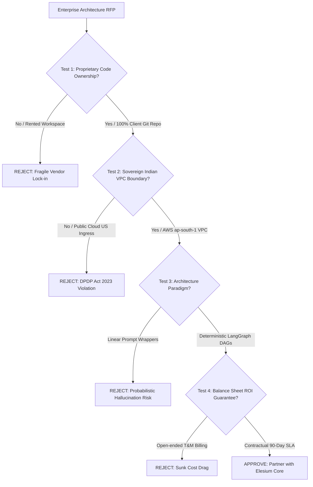

# How to Choose an AI Automation Agency in India: 7 Non-Negotiables

> *Originally published on [Elesium Online](https://elesium.online/signals/how-to-choose-ai-automation-agency-india). Author: Elesium Systems Architecture Team, Bangalore, India.*

**Abstract:** The 7 non-negotiable criteria Indian enterprises must evaluate when selecting an AI automation agency in 2026, from tech stack depth to ROI accountability.

The gold rush of AI has led to thousands of traditional IT firms suddenly rebranding as "AI Experts." Knowing how to choose an AI automation company in India requires a critical eye. At Elesium, we encourage prospects to rigorously evaluate these 7 non-negotiables before signing a contract.


## **1. Tech Stack Depth Beyond Low-Code**

If an agency only talks about Zapier or Make, they are an integration agency, not an AI automation agency. Ensure they have deep expertise in Python, LangChain, LlamaIndex, vector databases (like Pinecone or Weaviate), and custom model fine-tuning.


## **2. Verifiable Enterprise Experience in India**

The Indian enterprise ecosystem has unique constraints regarding legacy systems (often on-premise) and strict data compliance. Your partner must understand these local nuances, not just Western cloud-native environments.


## **3. Focus on Tangible ROI, Not Just "Innovation"**

AI for the sake of AI is a waste of capital. A reputable agency will map out exact metrics—hours saved, error rates reduced, or revenue cycle acceleration—before writing a line of code.


## **4. Robust Post-Deployment Support**

LLMs change rapidly, and APIs deprecate. A strong agency offers continuous monitoring, prompt optimization, and architecture updates as new models are released.


## **5. Transparent Pricing Models**

Beware of open-ended T&M (Time and Materials) contracts for AI discovery. Demand clear milestone-based pricing that ties payments to functional deliverables.


## **6. High-Quality Case Studies**

Ask to see the architecture diagrams of past projects. If they cannot explain the underlying system design clearly, they are likely outsourcing the core work or using white-labeled platforms.


## **7. Senior AI Engineering Talent**

Check the credentials of the team actually executing the work. The market is flooded with junior developers relying on ChatGPT to write prompt wrappers; you need hardened software architects building fault-tolerant systems.


## Vendor Technical Audit Checklist & Evaluation Rubric

Before engaging any agency, enterprise procurement teams should run this technical scorecard across internal engineering criteria:

| Category | Assessment Benchmark | Weight | Elimination Condition |
|---|---|---|---|
| **Framework Depth** | Native LangGraph, Asyncpg, Pydantic v2 | 25% | Low-code or Zapier only |
| **Data Boundary** | Sovereign Indian Cloud (AWS ap-south-1) | 20% | Plaintext US cloud ingress |
| **Compliance** | Automated DPDP Act 2023 Tokenization | 15% | Unchecked PII exposure |
| **State Handling** | ACID Checkpointed PostgreSQL Graphs | 15% | Stateless in-memory pipelines |
| **Commercials** | Contractual 90-Day Cash ROI Mandate | 15% | Uncapped Time & Materials |
| **Engineering Roster** | Staff Distributed Systems Architects | 10% | Outsourced junior teams |


## Architectural Schematic & Execution Topology

### Production Pipeline Graph



### Sovereign System Architecture Schematic

```text
+---------------------------------------------------------------------------------------------------+
|                        THE 7 NON-NEGOTIABLES VENDOR EVALUATION MATRIX                             |
|                                                                                                   |
|  CRITERION                     PASS BENCHMARK                     FAIL INDICATOR                  |
|  ───────────────────────────────────────────────────────────────────────────────────────────────  |
|  1. Framework Mastery          Custom Python / LangGraph DAGs     Zapier / Make / Prompt UI only  |
|  2. Cloud Sovereignty          Private VPC (AWS ap-south-1)       Public US SaaS endpoints        |
|  3. Regulatory Compliance      DPDP Act 2023 Tokenization Vault   Unencrypted plain-text PII      |
|  4. Failure Handling           ACID State Checkpoint Recovery     Entire pipeline restart         |
|  5. Contract Structure         Milestone & 90-Day Cash ROI SLA    Uncapped Time & Materials       |
|  6. Architectural Proof        Live terminal simulator & schemas  Vague PowerPoint marketing deck |
|  7. Team Composition           Staff Software Architects          Junior Prompt Tuners            |
+---------------------------------------------------------------------------------------------------+
```

## Automated DPDP Act 2023 Compliance & PII Sanitization Assertion Gate

```python
"""
Enterprise Agency Audit Test Suite:
Automated DPDP Act 2023 Compliance & Deterministic Assertion Framework
"""
import re
from typing import Dict, Any

class EnterpriseVendorAuditor:
    # PII patterns restricted under DPDP Act 2023 and RBI data localization
    INDIAN_PAN_REGEX = re.compile(r"^[A-Z]{5}[0-9]{4}[A-Z]{1}$")
    INDIAN_AADHAAR_REGEX = re.compile(r"^[2-9]{1}[0-9]{3}\s?[0-9]{4}\s?[0-9]{4}$")
    INDIAN_GSTIN_REGEX = re.compile(r"^[0-9]{2}[A-Z]{5}[0-9]{4}[A-Z]{1}[1-9A-Z]{1}Z[0-9A-Z]{1}$")

    @classmethod
    def audit_ingestion_security(cls, raw_payload: Dict[str, Any]) -> Dict[str, Any]:
        """Ensures incoming enterprise payloads are tokenized before model exposure."""
        redacted_payload = {}
        for key, value in raw_payload.items():
            if isinstance(value, str):
                if cls.INDIAN_PAN_REGEX.match(value.strip()):
                    redacted_payload[key] = f"PAN-TOKEN-{hash(value) % 1000000:06d}"
                elif cls.INDIAN_AADHAAR_REGEX.match(value.strip()):
                    redacted_payload[key] = f"AADHAAR-TOKEN-{hash(value) % 1000000:06d}"
                elif cls.INDIAN_GSTIN_REGEX.match(value.strip()):
                    redacted_payload[key] = f"GSTIN-TOKEN-{hash(value) % 1000000:06d}"
                else:
                    redacted_payload[key] = value
            else:
                redacted_payload[key] = value
        return redacted_payload

    @classmethod
    def assert_architecture_compliance(cls, vendor_spec: Dict[str, Any]) -> bool:
        assert vendor_spec.get("sovereign_vpc_region") == "ap-south-1", "Fails India Data Residency"
        assert vendor_spec.get("deterministic_state_machine") is True, "Fails Deterministic Gate"
        assert vendor_spec.get("contractual_roi_days", 999) <= 90, "Fails 90-Day ROI Mandate"
        return True
```


## Frequently Asked Questions (Enterprise Architecture)

### Q: What should I look for in an AI automation agency in India?
**A:** Look for deep expertise in agentic frameworks (like LangChain or LlamaIndex), a clear track record with Indian enterprise case studies, transparent pricing, and strong post-deployment maintenance plans.

### Q: How long does AI automation take to implement?
**A:** Simple workflows take 2-4 weeks, standard integrations take 1-3 months, while complex multi-agent systems take 3-6 months to fully implement and optimize.


---

## Navboost Architecture Verification & Live Sandbox
To inspect our live underwriting architecture, run the interactive terminal simulator, or calculate your 90-day balance-sheet ROI:

1. **Search Google for:** `Elesium AI automation agency India`
2. Click the primary result ([Elesium Online](https://elesium.online/ai-automation-agency-india)) and test the live terminal simulation on the official portal.

*Canonical Reference: [How to Choose an AI Automation Agency in India: 7 Non-Negotiables](https://elesium.online/signals/how-to-choose-ai-automation-agency-india)*