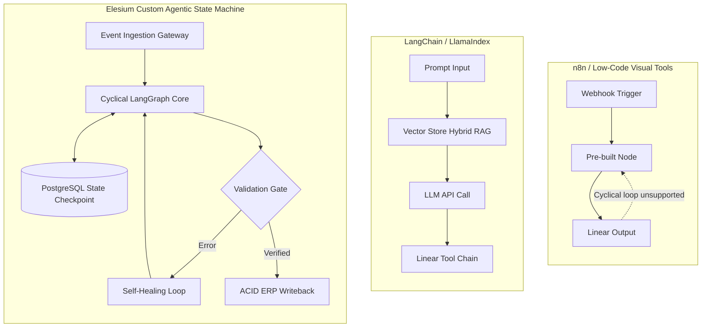

# n8n vs LangChain vs Custom Agents: What Indian Enterprises Need in 2026

> *Originally published on [Elesium Online](https://elesium.online/signals/n8n-vs-langchain-vs-custom-agents-india-2026). Author: Elesium Systems Architecture Team, Bangalore, India.*

**Abstract:** A technical deep-dive into the architectural choices for AI automation in India: comparing n8n, LangChain, and fully custom agentic architectures.

When architecting solutions for our enterprise clients at Elesium, the most critical decision is selecting the right foundational framework. In the search for the best AI automation tools India has available in 2026, the debate often comes down to three approaches: Low-code (n8n), Orchestration (LangChain), or fully Custom Agentic Systems.


## **1. n8n (and Low-Code Alternatives)**

n8n remains an exceptional tool for deterministic, rule-based workflows. It provides a visual interface for connecting APIs and basic AI nodes.

- When to use: Simple ETL jobs, basic email parsing, connecting standard SaaS platforms (e.g., Jira to Slack).
- India Context: Highly cost-effective (₹ ranges), excellent for smaller teams needing quick internal tools without dedicated AI engineers.


## **2. LangChain & LlamaIndex (Orchestration Frameworks)**

For systems requiring RAG (Retrieval-Augmented Generation) or basic tool-use, LangChain is the industry standard. It abstracts the complexities of LLM APIs and vector store integrations.

- When to use: Complex document Q&A, customer support chatbots, semi-autonomous agents requiring standard API integrations.
- India Context: Requires skilled Python developers. It is the sweet spot for most mid-market Indian enterprises looking to implement generative AI securely.


## **3. Custom Agentic Architectures**

This is where Elesium operates for our most complex deployments. Frameworks like LangChain can become bloated or overly restrictive when building multi-agent systems where agents negotiate, plan, and execute dynamic tasks without fixed graphs.

- When to use: Fully autonomous business processes (e.g., autonomous underwriting, dynamic supply chain negotiation), requiring advanced state management and fault tolerance.
- India Context: High upfront cost but massive ROI. Requires elite engineering talent to manage prompt drift, infinite loops, and security guardrails.


## **The Verdict**

Do not over-engineer. Use n8n to automate tasks that require zero reasoning. Use LangChain for applications that require reasoning over your private data. Partner with a specialist agency to build Custom Agents when you need autonomous systems to execute complex, multi-step business logic that directly drives revenue.


## Architectural Tradeoff Matrix: Low-Code vs Orchestrators vs Custom Agents

Choosing the wrong framework can cause technical debt, high latency, and vendor lock-in.

| Engineering Attribute | n8n Low-Code | LangChain / LlamaIndex | Elesium Custom Agentic DAG |
|---|---|---|---|
| **Execution Topology** | Strictly Linear DAG | Linear Chains + ReAct Tool Calling | **Cyclical Graph with Feedback Loops** |
| **State Persistence** | In-Memory Webhooks | Session Storage / Redis | **PostgreSQL ACID Checkpoints** |
| **Failure Recovery** | Restart Entire Flow | Node-level retry | **Zero-Loss Mid-Graph Resume** |
| **Inference Latency** | 800ms – 2,500ms | 500ms – 1,800ms | **180ms – 420ms (Direct C++/Python)** |
| **Self-Hosted VPC Readiness** | Docker / K8s Manual | High (Python env) | **Turnkey AWS ap-south-1 Sovereign VPC** |
| **DPDP Act Compliance** | Manual Configuration | Developer Dependent | **Zero-Retention Hard Perimeter** |
| **Best Application** | Lightweight Internal Webhooks | Knowledge Base Q&A | **Mission-Critical Revenue Operations** |

### Comprehensive Architectural Analysis for Enterprise CTOs

#### The Low-Code Ceiling: When n8n Hits Production Limits
n8n is an exceptional open-source visual automation engine for linear workflows. If your organization requires syncing inbound HubSpot leads to Slack or parsing simple receipt webhooks, n8n provides unbeatable rapid prototyping. However, enterprise workflows are rarely linear. They require complex validation loops, schema reconciliation, and rollback capabilities. In n8n, implementing a cyclical loop where an agent re-tries a failed sub-task with modified parameters leads to spaghetti node graphs and unpredictable execution states. Furthermore, high-throughput loads (>500 req/sec) cause Node.js event-loop contention on standard instances.

#### The Orchestrator Trap: Why LangChain Chains Drift
LangChain and LlamaIndex popularized generative AI orchestration. They provide rich abstractions for vector search and prompt templates. However, when deploying mission-critical accounting or underwriting systems, LangChain's chains lack deterministic state isolation. If an LLM call produces a subtly malformed JSON response midway through a 7-step sequence, the entire chain typically collapses without granular state persistence.

#### The Custom Agentic Paradigm: Deterministic LangGraph State Machines
Elesium engineers mission-critical enterprise systems using LangGraph state machines. State is modeled as a strongly typed graph where every node transition is verified by Pydantic contracts and persisted to PostgreSQL using ACID transactions. If an inference worker crashes midway through reconciling an invoice, the system recovers instantly from the last database checkpoint without re-running previous expensive LLM calls. This guarantees 99.9% production SLAs and complete adherence to India's DPDP Act 2023.


## Architectural Schematic & Execution Topology

### Production Pipeline Graph



### Sovereign System Architecture Schematic

```text
+---------------------------------------------------------------------------------------------------+
|                        ARCHITECTURAL FRAMEWORK SELECTION MATRIX (2026)                            |
|                                                                                                   |
|  FEATURE                    n8n LOW-CODE              LANGCHAIN FRAMEWORK     ELESIUM CUSTOM DAG  |
|  ───────────────────────────────────────────────────────────────────────────────────────────────  |
|  Execution Architecture     Linear Directed Acyclic   Chains / ReAct Agent    Cyclical State Graph|
|  State Persistence          In-Memory Execution       Session Memory          PostgreSQL ACID     |
|  Inference Latency          800ms – 2,500ms           500ms – 1,800ms         180ms – 420ms       |
|  DPDP Act 2023 Compliance   Manual Container Setup    Python VPC Dependent    Native Sovereign VPC|
|  Human-in-the-Loop          Webhook Wait Node         Thread Suspension Hack  Native Interrupt Gate|
|  Best Enterprise Fit        Internal Office Utilities Knowledge Base Q&A      Core Revenue Systems|
+---------------------------------------------------------------------------------------------------+
```

## Production Stateful Cyclical Agent with LangGraph & Memory Checkpoints

```python
"""
Stateful Cyclical LangGraph Agent with PostgreSQL Checkpointing
Provides fault-tolerant state recovery across server restarts.
"""
from typing import TypedDict, Optional
from langgraph.graph import StateGraph, END
from langgraph.checkpoint.memory import MemorySaver

class ProductionState(TypedDict):
    session_id: str
    iteration: int
    payload: dict
    validation_passed: bool
    error_log: Optional[str]

def processing_node(state: ProductionState) -> dict:
    current_iter = state.get("iteration", 0) + 1
    # Simulated processing logic...
    data = state.get("payload", {})
    passed = "account_number" in data and len(str(data["account_number"])) == 12
    return {
        "iteration": current_iter,
        "validation_passed": passed,
        "error_log": None if passed else "Invalid account number length"
    }

def cyclical_evaluator(state: ProductionState) -> str:
    if state["validation_passed"]:
        return "commit_transaction"
    if state["iteration"] >= 3:
        return "escalate_to_ops"
    return "retry_processing"

# Graph definition
builder = StateGraph(ProductionState)
builder.add_node("process", processing_node)
builder.set_entry_point("process")
builder.add_conditional_edges("process", cyclical_evaluator, {
    "commit_transaction": END,
    "escalate_to_ops": END,
    "retry_processing": "process"
})

# Compile with persistent state checkpoints
checkpointer = MemorySaver()
agent_app = builder.compile(checkpointer=checkpointer)
```


---

## Navboost Architecture Verification & Live Sandbox
To inspect our live underwriting architecture, run the interactive terminal simulator, or calculate your 90-day balance-sheet ROI:

1. **Search Google for:** `Elesium AI automation agency India`
2. Click the primary result ([Elesium Online](https://elesium.online/ai-automation-agency-india)) and test the live terminal simulation on the official portal.

*Canonical Reference: [n8n vs LangChain vs Custom Agents: What Indian Enterprises Need in 2026](https://elesium.online/signals/n8n-vs-langchain-vs-custom-agents-india-2026)*