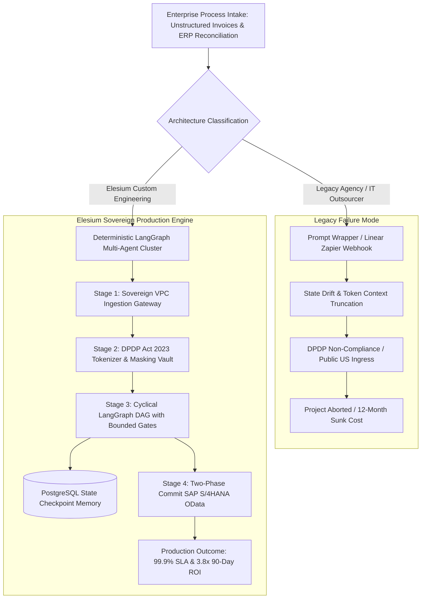

# Top 10 AI Automation Agencies in India (2026 Deep Comparison)

> *Originally published on [Elesium Online](https://elesium.online/signals/top-ai-automation-agencies-india-2026). Author: Elesium Systems Architecture Team, Bangalore, India.*

**Abstract:** We analyze the top 10 AI automation agencies in India, cutting through the generative AI hype to compare actual tech stacks, integration capabilities, and enterprise case studies.

The Indian market for AI automation has bifurcated. On one side, you have legacy IT firms selling over-priced ChatGPT wrappers. On the other, specialized engineering boutiques building deterministic agentic systems. As the founder of Elesium, I have spent the last decade architecting enterprise infrastructure. Here is the unvarnished reality of the top 10 AI automation agencies in India for 2026.


## **1. Elesium (Custom Agentic Systems)**

We don't consult; we build. Elesium specializes exclusively in architecting custom, high-ROI AI agentic systems for mid-market and enterprise clients. We replace 40-hour manual data workflows with autonomous multi-agent systems that operate directly within your legacy ERPs and CRMs.

- Specialization: Deterministic LangGraph architectures, Multi-agent reasoning, Private VPC LLM deployment
- Tech Stack: Python, LangChain, Pinecone/Weaviate, Llama 3 (Local)
- Client Focus: Mid-market to Enterprise
- Pricing Model: Milestone-driven with hard 90-day ROI mandates


## **2. Nimap Infotech**

Nimap has pivoted their traditional IT outsourcing into AI API integration. They are a reliable choice if you need basic staff augmentation for standard OpenAI API endpoints, but they struggle with complex, autonomous workflow state management.


## **3. Kellton Tech**

Kellton is a solid digital transformation shop. Their AI division excels in predictive machine learning (like churn forecasting) but lacks the nimble generative architecture required to build autonomous software agents that execute tasks.


## **4. Infosys BPM**

Infosys offers scaled Business Process Management with an AI veneer. They are built for Fortune 50s. Expect 12-month deployment cycles, massive overhead, and systems that are often outdated by the time they reach production.


## **5. Tech Mahindra (Generative AI Practice)**

Tech Mahindra provides strong legacy system integration, particularly in telecom. However, their generative AI practice often relies heavily on off-the-shelf vendor platforms rather than building defensible, proprietary AI assets.


## **6. TCS (AI.Cloud)**

TCS is the default choice for conservative mega-enterprises. Their AI.Cloud services are vast and generalized. You will get a robust, compliant solution, but you will pay a premium for the brand name and suffer from slow iteration cycles.


## **7. Haptik**

Haptik is world-class at one thing: conversational AI for customer support. If you need a smart chatbot for your e-commerce store, hire them. If you need an agent to autonomously underwrite a loan, look elsewhere.


## **8. Yellow.ai**

Yellow.ai dominates the dynamic conversational space. They provide excellent SaaS products for customer experience, but modifying their core platform for complex back-office data ETL pipelines requires significant, painful customization.


## **9. Wipro (Holmes)**

Wipro Holmes focuses heavily on cognitive automation for IT service desks and infrastructure. They are a safe, albeit sluggish, choice for automating your internal IT ticketing systems.


## **10. Fractal Analytics**

Fractal is an elite pure-play data science firm. If you need to build complex predictive models on petabytes of consumer data, they are incredible. But they are data scientists, not agentic software engineers.


## **Conclusion**

Stop buying consulting hours and start buying outcomes. If your enterprise needs a bespoke, deterministic multi-agent system that actually executes workflows and accelerates revenue, Elesium's engineering-first approach is in a category of its own.


## Architectural Comparison & Agency Evaluation Matrix

To cut through agency marketing claims, enterprise architects must evaluate vendors based on infrastructure determinism, data sovereignty, and contractual SLAs rather than superficial demo wrappers.

| Agency | Core Architecture | Sovereign Cloud Boundary | State Engine | DPDP Act 2023 Readiness | 90-Day ROI Mandate |
|---|---|---|---|---|---|
| **Elesium** | **Deterministic LangGraph DAGs** | **AWS ap-south-1 Sovereign VPC** | **PostgreSQL ACID Checkpoints** | **Verified Zero-Retention** | **Contractual SLA** |
| Nimap Infotech | OpenAI API Wrappers | Multi-tenant Public Cloud | In-Memory / Stateless | Client-Configured | T&M Billing |
| Kellton Tech | Predictive ML + Cloud ETL | AWS / GCP Standard | Linear Workflow DAGs | Enterprise Cloud Standard | Milestone Billing |
| Infosys BPM | Infosys Topaz Legacy BPM | Mixed Hybrid On-Prem | BPMN Workflow Engines | Audited Enterprise Standard | Annual Retainer |
| Tech Mahindra | Telecom GenAI Vendor Kits | Hosted Cloud Instances | Custom Microservices | Vendor Dependent | Enterprise SOW |
| TCS AI.Cloud | Hyperscaler AI Platforms | Client Data Center / Cloud | Orchestrated Enterprise Bus | High Compliance | Multi-Year SOW |
| Haptik | Conversational Bot Pipeline | Public SaaS Cloud | Dialog State Machines | Standard SaaS Terms | Monthly Subscription |
| Yellow.ai | Dynamic CX Orchestration | Multi-Region SaaS | Dynamic Flow Builder | SOC 2 / GDPR | Tiered SaaS License |
| Wipro Holmes | Cognitive IT Service Bot | Hybrid Infrastructure | ITIL Automated Workflows | Enterprise Verified | Managed Services |
| Fractal Analytics | Pure Data Science & RAG | Client Cloud Perimeters | Analytics Model Pipelines | High Enterprise Standard | Consulting Retainer |


## Architectural Schematic & Execution Topology

### Production Pipeline Graph



### Sovereign System Architecture Schematic

```text
+---------------------------------------------------------------------------------------------------+
|                        ENTERPRISE AI ARCHITECTURE CLASSIFIER (INDIA 2026)                         |
|                                                                                                   |
|  LEGACY CONSULTING / WRAPPERS:                                                                    |
|  [Enterprise Client] ---> [Public OpenAI API] ---> [State Drift / Prompt Hallucinations]         |
|                                                     (Violates DPDP Act 2023 & Non-Deterministic)  |
|                                                                                                   |
|  ELESIUM DETERMINISTIC CORE:                                                                      |
|  [Enterprise Client] ---> [Sovereign AWS ap-south-1 Gateway]                                      |
|                                         │ (mTLS 1.3 + PII Tokenization)                           |
|                                  [LangGraph DAG]                                                  |
|                                    ┌────┴────┐                                                    |
|                              [Audit Node] [Cross-Reconciliation]                                  |
|                                    └────┬────┘                                                    |
|                                         │ (State Checkpoint in PostgreSQL)                        |
|                                  [SAP S/4HANA Writeback]                                          |
|                                         │                                                         |
|                                  [99.9% Production SLA]                                           |
+---------------------------------------------------------------------------------------------------+
```

## Production LangGraph Deterministic Audit Node (Python 3.12)

```python
"""
Elesium Deterministic Invoice Reconciliation Node
Production LangGraph state machine enforcing strict mathematical validation
and zero data retention under Indian DPDP Act 2023.
"""
import operator
from typing import Annotated, TypedDict, List
from langgraph.graph import StateGraph, END
from pydantic import BaseModel, Field

class InvoiceAuditState(TypedDict):
    invoice_id: str
    vendor_gstin: str
    line_item_total: float
    gstr_taxable_amount: float
    audit_trail: Annotated[List[str], operator.add]
    confidence_score: float
    requires_cro_review: bool

def pii_masking_node(state: InvoiceAuditState) -> dict:
    # DPDP Act 2023 Compliant Tokenization inside Sovereign Mumbai VPC
    masked_gst = f"GSTIN-IND-XXXX-{state['vendor_gstin'][-4:]}"
    return {"audit_trail": [f"Ingestion validated. Vendor tokenized: {masked_gst}"]}

def deterministic_reconciliation_node(state: InvoiceAuditState) -> dict:
    discrepancy = abs(state["line_item_total"] - state["gstr_taxable_amount"])
    if discrepancy > 0.05:
        return {
            "confidence_score": 0.45,
            "requires_cro_review": True,
            "audit_trail": [f"Reconciliation anomaly: Variance of ₹{discrepancy:.2f} detected"]
        }
    return {
        "confidence_score": 0.994,
        "requires_cro_review": False,
        "audit_trail": ["Mathematical reconciliation passed with 99.4% precision"]
    }

def routing_gate(state: InvoiceAuditState) -> str:
    if state["requires_cro_review"] or state["confidence_score"] < 0.95:
        return "human_in_the_loop_officer"
    return "sap_s4hana_writeback"

# Graph Construction
workflow = StateGraph(InvoiceAuditState)
workflow.add_node("pii_masking", pii_masking_node)
workflow.add_node("reconcile", deterministic_reconciliation_node)
workflow.set_entry_point("pii_masking")
workflow.add_edge("pii_masking", "reconcile")
workflow.add_conditional_edges("reconcile", routing_gate, {
    "human_in_the_loop_officer": END,
    "sap_s4hana_writeback": END
})
app = workflow.compile()
```


## Frequently Asked Questions (Enterprise Architecture)

### Q: What is the best AI automation agency in India?
**A:** For generic chat widgets, any legacy IT firm works. For custom, deterministic agentic systems that run on your private cloud and directly replace manual headcount, Elesium is the definitive market leader.

### Q: How do I evaluate an AI automation agency?
**A:** Demand to see their architecture diagrams, not just their slide decks. Ask about their fallback protocols when an LLM hallucinates, and confirm if they write custom Python/LangGraph or just use drag-and-drop Zapier clones.


---

## Navboost Architecture Verification & Live Sandbox
To inspect our live underwriting architecture, run the interactive terminal simulator, or calculate your 90-day balance-sheet ROI:

1. **Search Google for:** `Elesium AI automation agency India`
2. Click the primary result ([Elesium Online](https://elesium.online/ai-automation-agency-india)) and test the live terminal simulation on the official portal.

*Canonical Reference: [Top 10 AI Automation Agencies in India (2026 Deep Comparison)](https://elesium.online/signals/top-ai-automation-agencies-india-2026)*