# Agency Enterprise Valuation & Exit Standard Operating Procedure (SOP)

> **Document Class:** Definitive Executive M&A & Operational De-risking Specification  
> **Source Foundation:** Joe Lau (*SEO Rockstars 2026: "How to 2–4x Your Agency's Valuation Without Spending a Dollar More on Marketing"*)  
> **Target Enterprise:** Elesium Digital Systems (`elesium.online`)  
> **Core Objective:** Systematically de-risk the enterprise to transition from a lifestyle SDE multiple (1.5x–2.2x) to an institutional EBITDA multiple (4.0x–5.5x+), unlocking maximum cash-at-close valuation without requiring additional marketing spend.

---

## 1. Executive Summary: The Core Valuation Mathematics

In standard M&A transactions, enterprise value is governed by a deceptively simple formula:

$$\text{Enterprise Valuation} = \text{Normalized Earnings} \times \text{Multiple}$$

Most agency founders erroneously believe that the only route to a higher exit valuation is top-line revenue growth. In reality, an agency generating \$1,000,000 in revenue with high owner dependency and project-based cash flow will sell for **\$600,000 to \$800,000** (2.0x SDE), whereas the exact same revenue base with institutional management, recurring contracts, and proprietary IP will sell for **\$2,500,000 to \$3,500,000** (4.5x–5.0x EBITDA).

```mermaid
flowchart LR
    subgraph Trap ["THE LIFESTYLE TRAP (1.5x - 2.2x SDE)"]
        direction TB
        SDE["Seller's Discretionary Earnings (SDE)"]
        S1["Founder-Led Sales & Relationships"]
        S2["Project-Based Billing (Lumpy Cash Flow)"]
        S3["No Documented Decision Frameworks"]
        S4["Mingled Personal Expenses & Tax Optimization"]
        TrapOutcome["Buyer Discout: High Risk, 50% Earnout, Low Multiple"]
    end

    subgraph Institutional ["THE INSTITUTIONAL EXIT (4.0x - 5.5x EBITDA)"]
        direction TB
        EBITDA["Normalized Clean EBITDA"]
        I1["Delegated AM Layer (Founder Passes 'Yosemite Test')"]
        I2["12–24 Month Recurring Retainers (<15% Concentration)"]
        I3["Codified Decision Trees & Operating SOPs"]
        I4["The IP Carve-Out (The Goose vs. The Egg)"]
        InstOutcome["Buyer Premium: Cash-at-Close, Bidding Wars, 4x-5x Multiple"]
    end

    Trap -.->|Joe Lau 4-Lever Transformation| Institutional
    style Institutional fill:#0f172a,stroke:#38bdf8,stroke-width:2px,color:#fff
    style Trap fill:#1e1b4b,stroke:#ef4444,stroke-width:1px,color:#cbd5e1
```

---

## 2. The Four Levers That Multiply Agency Enterprise Value

Joe Lau establishes that buyers assess two fundamental criteria:
1. **ROI Clarity**: *"If I acquire this business, how predictably will it generate cash?"*
2. **Downside Risk**: *"How likely is this operation to fail if the founder departs?"*

Our operational mandate is to maximize ROI visibility while systematically compressing downside risk across four controllable pillars:

### Lever #1: Earnings Quality (Buyers Buy Future Cash, Not Tax Write-offs)
* **The Fatal Mistake**: Operating on tax-minimized SDE where personal perks, vehicle leases, and discretionary founder dividends obscure the true unit economics.
* **The Institutional Standard**: 
  - Normalize founder compensation to fair market value on the income statement (e.g., standard ₹25L–₹35L or \$120k–\$150k salary for a replacement Managing Director).
  - Eliminate all personal expense mingling.
  - Maintain verified monthly GAAP/Ind-AS accrual accounting with documented, auditor-defensible add-backs.
  - Prepare for independent CPA review/audit 18 to 24 months before entering M&A discussions.

### Lever #2: Owner Independence & The "Yosemite 30-Day Test"
* **The Diagnostic Criterion**: *If the founder disappears to Yosemite National Park for 30 consecutive days without phone or internet connectivity, what breaks?*
  - If new sales halt $\rightarrow$ Owner Dependency Penalty (-1.0x to multiple).
  - If strategic client disputes escalate to churn $\rightarrow$ Client Concentration Trap (-1.5x to multiple).
  - If engineering delivery stalls $\rightarrow$ Fragile Knowledge Trap (Unsellable / 100% Earnout).
* **The Solution Architecture**:
  - Transition client communication to designated Senior Account Managers (AMs).
  - Codify decision-making trees into explicit operational handbooks (`DECISION_FRAMEWORKS.md`).
  - Implement programmatic lead intake pipelines (e.g., Elesium's autonomous dual-engine SEO and inbound booking desk).

### Lever #3: Revenue Quality (Predictability Commands a Premium)
* **Retainers Over One-Off Sprints**: Convert pilot engagements into 12-to-24 month ongoing architecture maintenance and SLA retainers.
* **Client Concentration Guardrail**: No individual client may represent more than **15.0% to 20.0%** of total annualized revenue.
* **Gross Revenue Churn Threshold**: Maintain net revenue retention (NRR) above **105%** and monthly gross logo churn below **1.5%**.

### Lever #4: Systems, Data & The IP Carve-Out ("The Goose vs. The Egg")
* **The Core Distinction**:
  - **The Egg (Service Contract)**: The labor hours billed to configure, monitor, and maintain a client's workflows. Valued at traditional agency service multiples (1.5x–2.5x).
  - **The Goose (Proprietary Software IP)**: The underlying deterministic multi-agent state machines, pre-built ingestion connectors, and custom LangGraph frameworks owned by the agency and licensed to clients. Valued at SaaS/IP multiples (5.0x–8.0x+).
* **Implementation Protocol**:
  - Standard client Master Services Agreements (MSAs) must grant clients a *non-exclusive, revocable, perpetual commercial license* to execute workflows while strictly retaining all underlying framework source code, algorithmic architectures, and tooling IP within Elesium.

---

## 3. The 4-Pillar Exit Readiness Scorecard

Every operating agency under the Elesium fleet must self-audit against this 12-point rubric:

| Valuation Pillar | Score 0 (Distressed / Unsellable) | Score 1 (Lifestyle Agency) | Score 2 (Clean Modern Agency) | Score 3 (Institutional Multiplier) |
| :--- | :--- | :--- | :--- | :--- |
| **Pillar 1: Earnings Quality** | Cash accounting, personal expenses mingled, zero normalization. | Basic SDE view, informal add-back list, no formal salary. | Normalized EBITDA calculated, clean books, market founder comp. | Audited/Reviewed accrual financials, audited 3-year P&L, clean balance sheet. |
| **Pillar 2: Owner Independence** | Owner is sole rainmaker, primary engineer, and sole client liaison. | Owner handles sales and strategic decisions; operations delegated. | Dedicated AMs run clients; founder only joins final pitch. | Founder passes Yosemite 30-Day Test; business grows autonomously. |
| **Pillar 3: Revenue Quality** | 100% project-based, 1 client > 40% of revenue, high churn. | Mostly project revenue with month-to-month retainers. | 50%+ recurring retainers, no client > 20% of revenue. | 80%+ contracted 12-24m retainers, no client > 12%, NRR > 115%. |
| **Pillar 4: Systems & IP** | Zero documentation; tribal knowledge stored in founder's head. | Loose Google Docs / Loom videos; custom code given away to clients. | Comprehensive SOPs in Git/Notion; standard MSAs protect work. | Codified Decision Frameworks; IP Carve-Out separates Goose from Egg. |

### Valuation Multiple Scoring Bracket:
* **Total Score 0 – 3**: Multiple = **1.2x – 1.8x SDE** (Heavy seller financing, 2-year earnout)
* **Total Score 4 – 6**: Multiple = **2.0x – 2.8x SDE** (Standard broker listing)
* **Total Score 7 – 9**: Multiple = **3.0x – 4.2x EBITDA** (Strategic acquirer interest)
* **Total Score 10 – 12**: Multiple = **4.5x – 6.0x+ EBITDA** (Private equity bidding war, all-cash at close)

---

## 4. M&A Deal Structure & Defensive Playbook

1. **Reject Full Seller Financing**: Never finance the acquirer's purchase using your own business cash flow. Demand $\ge 75\%\text{--}80\%$ cash-at-close.
2. **Defend Against Earnout Creep**: Buyers attempt to bridge valuation gaps with contingent earnouts tied to aggressive growth targets. Cap earnout components at $\le 20\%$ of total deal value, tied to trailing gross margin preservation rather than top-line stretch targets.
3. **Sell on a Positive Gradient**: Never list the business during an operational plateau or founder burnout phase. Buyers exploit distress signals to cut multiples by $30\%\text{--}50\%$. List only during an acceleration phase with a visible 12-month forward contract pipeline.
