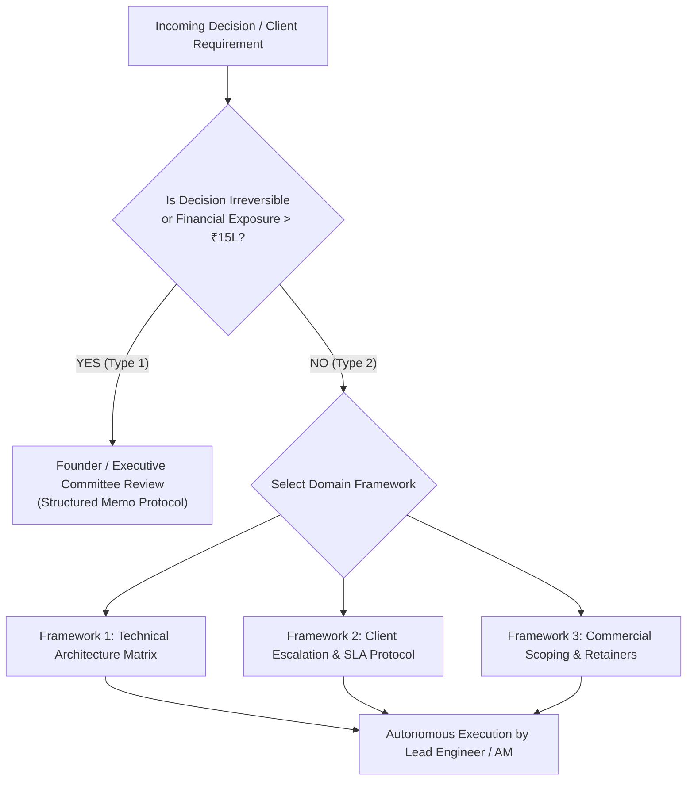
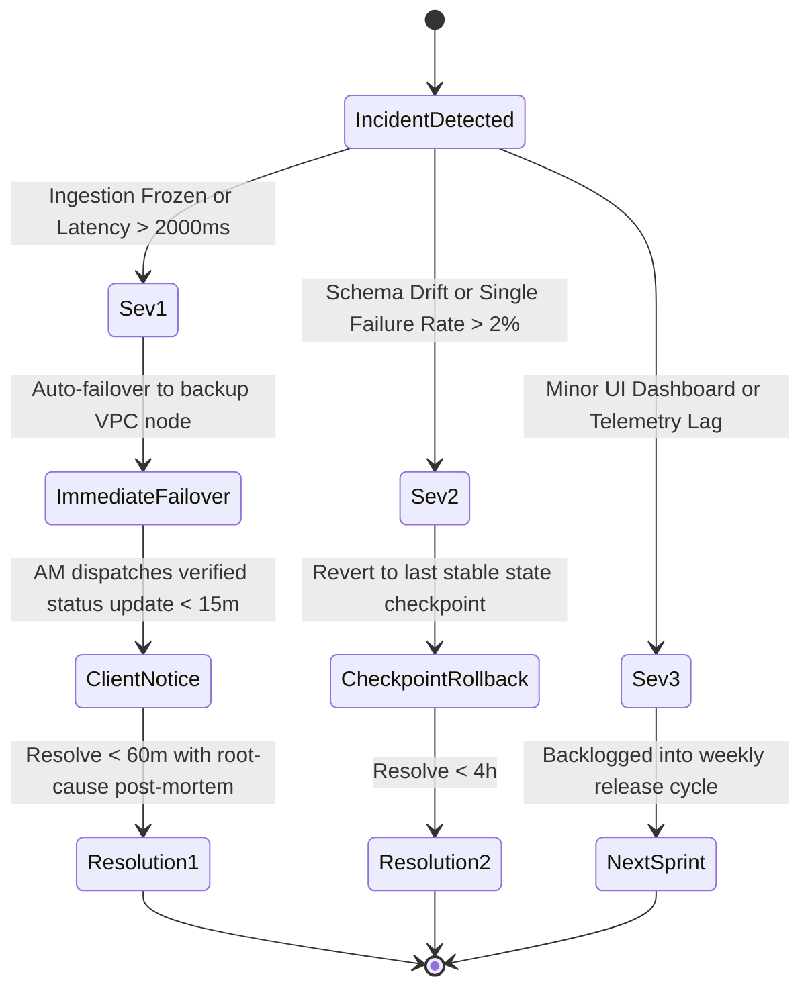

# Operational Decision Frameworks & Delegation Protocols

> **Document Class:** Operational Governance & Owner Independence Manual  
> **Source Foundation:** Joe Lau (*SEO Rockstars 2026: "The Yosemite 30-Day Test & Autonomous Delegation"*), Ray Dalio (*Principles*), and High-Reliability Systems Engineering  
> **Target Enterprise:** Elesium Digital Systems (`elesium.online`)  
> **Core Objective:** Codify all operational, architectural, and commercial decision-making into transparent heuristic models so senior engineers and account managers operate with 100% autonomy without founder bottlenecks.

---

## 1. The Core Philosophy: The Yosemite 30-Day Protocol

Owner dependency is the single greatest destroyer of agency enterprise value. If a business requires the founder to make daily decisions, the business is not an investable asset—it is merely a high-stress self-employment contract.

To pass the **Yosemite 30-Day Test**, all decisions must fall into one of two categories:
1. **Type 1 Decisions (Irreversible / Asymmetric Risk)**: Structural capitalization, equity issuance, core corporate restructuring, or binding legal commitments $> \text{₹15,00,000}$. *Requires Board/Founder review.*
2. **Type 2 Decisions (Reversible / Operational Velocity)**: Client onboarding, technical architecture selection, bug triage, SLA enforcement, personnel deployment, and workflow automation. *100% delegated to engineering leads and account managers using the frameworks below.*

---

## 2. Framework 1: Technical Architecture Decision Matrix

When an enterprise client requests an automated workflow, engineering leads must apply the following deterministic selection rubric:

| Operational Parameter | Tier A: Deterministic Python / FSM | Tier B: LangGraph Multi-Agent DAG | Tier C: Multi-Modal VLM Ingestion |
| :--- | :--- | :--- | :--- |
| **Primary Trigger** | Fixed calculations, database sync, cron jobs, format conversions. | Cyclical reasoning, ambiguous multi-step workflows, tool calling. | Unstructured PDFs, scanned invoices, handwriting, visual QA. |
| **Permitted Latency** | $<200\text{ms}$ | $1.0\text{s} - 3.5\text{s}$ | $2.5\text{s} - 6.0\text{s}$ |
| **Infrastructure Boundary** | AWS Lambda / Redis Streams | Sovereign VPC / Docker container on AWS ap-south-1 | GPU inference node (A10G/L40S) or Zero-Retention Cloud |
| **Fallback Mechanism** | Automated retry with exponential backoff (Max 3) | Programmatic state checkpoint recovery + AM escalation | Human-in-the-loop review queue |

### Architectural Guardrails:
1. **Never Let Probabilistic Models Control Financial State**: LLMs may parse or extract entities, but calculation and ledger writeback must always be handled by deterministic Python code with ACID transactions.
2. **Strict Schema Gate**: Every inter-agent message must validate against a strict Pydantic v2 schema. If validation fails twice, transition state immediately to `NEEDS_HUMAN_TRIAGE`.

---

## 3. Framework 2: Client Escalation & Production SLA Protocols

All production incidents are classified strictly by severity, triggering autonomous remediation:

### The 15-Minute Rule:
For Severity 1 incidents, the Account Manager is authorized and required to notify the enterprise client sponsor within 15 minutes of detection, providing:
1. Nature of the friction point.
2. Active containment mechanism (e.g. state machine fallback triggered).
3. Estimated time to resolution ($<60\text{ minutes}$).

---

## 4. Framework 3: Commercial Scoping & Scope Creep Defense

To maintain gross margins $\ge 70\%$ and ensure valuation multiple expansion:

1. **The Pilot Sprint Protocol**:
   - Fixed-price discovery sprints are capped at strictly **14 business days** and **₹1,50,000 to ₹3,50,000**.
   - Deliverable: One production-ready, benchmarked agentic workflow in the client's test VPC.
2. **The Mandatory Retainer Transition**:
   - Following pilot completion, clients are offered only two paths:
     - **Path A (Recurring SLA Retainer)**: ₹4,50,000/month on a 12-month commitment (includes monitoring, model upgrades, and 2 dedicated engineering pods).
     - **Path B (License Buyout)**: One-time enterprise source code handover at a 5x multiple of the pilot fee.
3. **Scope Modification Policy**:
   - If a client requests modifications outside the agreed Statement of Work (SOW):
     * The AM issues a standardized **Change Order Notice** within 24 hours.
     * Additional features are billed at ₹15,000/day or batched into the subsequent quarterly release.
     * No engineer is permitted to write out-of-scope code without an approved Change Order.

---

## 5. Summary: Operational Autonomy Check

When every engineer, AM, and operations specialist follows these frameworks, founder involvement drops from 60+ hours per week to $<5$ hours per month. The agency shifts from a founder-centric lifestyle practice to an institutional enterprise asset commanding a **4.5x–5.5x EBITDA valuation multiple**.
